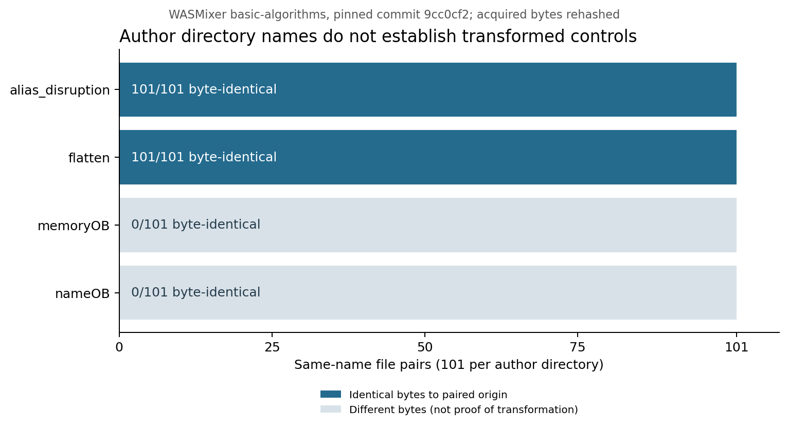

# 対照を使った個別解析

2026-10-06。第1段階20種類に第2段階11種類を追加し、計31種類をCodexが個別に静的に確認した。別の研究者による確認は未実施であり、研究全体は継続中である。

## 選定と証拠

乱数シードを20261007に固定し、WASMixerの名前付き基本アルゴリズムからdekhash/vowels、realworld_programからmd5、初期Cryptic Bytes対照12プログラムからf1-raceを選び、通常版・変換版を対にした。基本アルゴリズムの数値が名前になっている合成テストは、今回の選定対象に含まない。選定単位はプログラムで、11個のファイルを、それぞれ独立した悪性ファイルの事例として扱わない。

[選定記録](../experiments/review-selection-stage2.json)、[判断台帳](../results/cases/review-decisions-stage2.json)、[確認箇所の一覧](../results/cases/review-index.csv)。確認箇所に限定した判断であり、全コードを人間が監査したという意味ではない。

## 配布時のラベルと実際のバイト列

WASMixer固定コミット`9cc0cf2db8fdf9e9726a5ec41883d4595185a1bd`のbasic-algorithmsで同名originを照合し、取得したファイルのバイト列のSHA-256を再計算した。

|配布ディレクトリ|ペア数|originと完全一致|各ディレクトリ内の異なるSHA-256の数|
|---|---:|---:|---:|
|alias_disruption|101|101|99|
|flatten|101|101|99|
|memoryOB|101|0|101|
|nameOB|101|0|101|

この版のflatten/alias_disruptionを、originに変換を加えたと確認できる例として扱う根拠はない。一方、origin自体に難読化がないことを証明したものでもない。realworld_programの同名ペアは別で、すべてバイトが異なる。論文の提案手法が無効だという結論にはしない。

[全420ペア](../results/controls/wasmixer-pairs.csv)は`scripts/audit_control_pairs.py`で再生成できる。著者ディレクトリ名と実測した変化を別フィールドで保持する。

## 名前変更と再符号化

dekhashのDEKHashはmduahvzb、vowelsのmainはypzncwheに変わる。名前注釈を除く逆アセンブルした命令・数値オペランド・ローカル宣言は、dekhash全53関数、vowels全55関数で一致した。

コードセクションのバイトは異なるが、例えばglobal.getのインデックス0はパディングされたLEB表現から短い表現に変わっている。コードセクションのハッシュ差は処理内容の変更と同義ではない。この照合だけでは、モジュール全体が同じ動作をすることは証明できない。

## 制御フロー平坦化と間接呼び出し

md5の通常版to_bytesは整数を0・8・16・24ビットずらして4バイトへ順に書く。flatten版ではlocal 20を状態にしてループ内のbr_tableへ渡す。各処理ブロックは状態を更新して同じ分岐処理へ戻り、確認した状態値の遷移は0→2→4→1→5→3→6である。状態の定義・更新・復帰と対照との差を平坦化の根拠にした。

callindirect版では、内部_startのcall 21/31がテーブル添字54/20を使うcall_indirectに変わる。エレメントセクションの54番=func21、20番=func31も照合した。一般の関数ポインタを難読化とする判定ではない。

f1-raceのTigress版mainはlocal5+88へ状態を保存し、ループ内で読み取って27個の要素を持つ分岐表を参照する。状態23・10・18等の書戻しと復帰を確認した。通常版mainに分岐表はない。一方、モジュール全体のbr_tableは通常版701、Tigress版738箇所で、ライブラリを含む総数と難読化の確認箇所は区別する。

## XORと実際の鍵

dekhash/vowelsのmemoryOB版では直接のメモリ読み書きが補助関数の呼び出しに変わる。補助関数はアドレス範囲とアクセス幅で分岐し、global 1とのi64.xorを含む。

ただし両バイナリでglobal 1の初期値は0、全命令にglobal.set 1がなく、globalのimport/exportもない。したがって、このXORを0以外の鍵によるデータ暗号化の確認例には数えない。確認できたのは、メモリ操作を補助関数経由に変えたことである。この2例を他のバイナリや論文全体へ一般化しない。

元ファイルはカスタムセクションのメタデータが原因でWABTの検証に失敗するため、カスタムセクションを除き、検証に通った本体を逆アセンブルした。記載したオフセットは、その本体の位置である。元ファイルの検証に成功したという意味ではない。

[命令・global・テーブル比較](../results/controls/stage2-comparisons.json)は`scripts/compare_control_reviews.py`で再生成する。これらの対照例を実際に収集したマルウェアでの出現割合の代わりにはしない。
