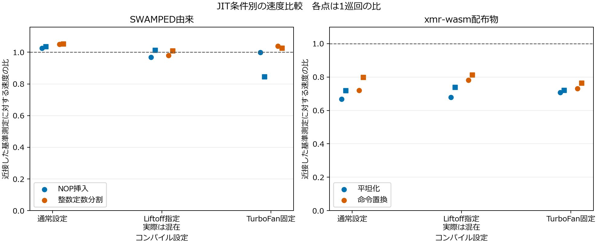

# 難読化前後の追加評価とコード正規化検討の進捗

2026年10月16日。既存の構造分析・出力照合・速度測定を保持し、その不足を補う追加評価を進める。構造・正しさ・性能の評価を先に行い、結果からコード正規化の適用範囲と開発課題を検討する。

全272ブロックの性能評価、77条件の正規化後の2,793照合、4,508関数・56モジュールの照合課題、図5点の目視確認が完了した。別枠の再現確認でも77条件・2,793照合が一致した。結果は [統合報告](followup-research-report-20261016.md)、[性能評価](followup-performance-results-20261016.md)、[正規化比較](followup-normalization-results-20261016.md) にまとめた。最終の要求照合は [完了監査](../results/followup-evaluation-20261016/completion-audit.json) で確認する。

## 既存成果の継承

現行論文のRQ1・RQ2、13バイナリの出力・構造・速度の対応、SWAMPED由来23SHA・138測定、通常処理と計測コードの対照、Binaryenとの比較、式の読み取り支援を引き継ぐ。新しい難読化方式の発明実験は対象外とする。

既存の生ログ・原本・計画・許可記録は保持する。追加評価は `results/followup-evaluation-20261016/` に保存し、現在の論文を置き換える前に結果と反映案を別にまとめる。

## 入力履歴依存の原因

SWAMPEDの基準版と、そのNOP挿入版・整数定数分割版の3件を測定した。基準版の `_cryptonight_hash_variant_0` は、引数の見た目では長さを受け取るが、第4引数を最初に一時スタックアドレスで上書きし、入力先頭76バイトを固定して読み込む。長さに従って任意長のメッセージを処理する入口ではない。

長さ引数を0、1、8、32、75、76、77、128、255に変えても、同じ76バイトのバッファ内容なら公表入力と同じ出力になった。3版で計27条件を確認した。入力の76バイト目を変更すると出力が変わり、その次のバイトや76バイトより後の領域を変えても、公表入力の出力は変わらなかった。

短入力について、新規状態、別の公表入力を処理した後、バッファ末尾をゼロまたは255で埋める条件を組み合わせ、81条件を確認した。すべて、実際のバッファ先頭76バイトを新規状態で処理した基準出力と一致した。保持した末尾によって結果が変わり、末尾を同じ内容にすると履歴間で一致した。これにより、今回観察した履歴依存は固定幅読取りと残存入力の組合せで再現できた。

実効76バイト入力は14種類あり、すべて別配布のwebminerpoolhashcn実装と一致した。xmr-wasmも、cn/0を選択できる2種類で一致した。両参照実装は先に公表入力を照合した。共有するアルゴリズムやコード由来があり、形式的な独立証明ではない。

根拠は [静的入力契約](../results/followup-evaluation-20261016/static-input-contract.json)、[関数冒頭の命令列](../results/followup-evaluation-20261016/baseline-input-entry.wat.txt)、[実測ログ](../results/followup-evaluation-20261016/runs/input-diagnostic-17d5dd4803304d40b16c07fb221a2747/outputs/input-diagnostic.json)、[監査結果](../results/followup-evaluation-20261016/input-audit.json)である。計画・入力・コードのSHA、実コンテナ制限、終了コード0、OOMなしも監査した。

## 既存結果への影響

3版の公表76バイト入力5件、計15照合はすべて期待値と一致した。既存の速度測定が使った公表入力の出力検証は、この発見だけでは否定されない。

一方、以前の追加12入力には76バイト未満・超の入力が含まれていた。これらの一致は、今回の固定幅入口に対する差分検証であり、指定された長さの任意メッセージについてCryptoNightの正しい出力を独立検証したものではない。論文にある短入力の原因未特定という説明は、今回の結果に基づいて更新する必要がある。以後の主測定は有効な76バイト入力を使う。

## 性能評価の予備測定

SWAMPEDの基準・NOP挿入・整数定数分割、xmr-wasmの基準・平坦化・命令置換の6バイナリについて、通常、Liftoff指定、TurboFan指定を比較した。各条件2巡回、計72ブロックを事前固定した。各ブロックは新しいNodeプロセスで実行し、5秒以上のウォームアップと10秒以上の測定を行った。基準を連続させたA/Aと、基準・変換・基準の近接比較を含む。

CPU使用量上限1に加え、ゲストCPU0への配置を指定する。経過時間、CPU時間、cgroupのCPU統計、1秒程度の区間速度、コンパイル記録、前後・最終出力を保存する。Docker DesktopのゲストCPU指定は、ホスト物理コアの排他的使用を意味しない。

実行条件は既存と同じNode18.20.4、V8 10.2.154.26-node.37、固定Dockerイメージである。ネットワークnone、メモリ・swap合計上限1GiB、pids64、非root、入力とrootの読み取り専用化、cap-drop ALL、no-new-privilegesを実際のinspectで確認する。

72ブロックは終了コード0・OOMなしで完了し、出力・計数・時間・入力SHA・隔離設定の監査を通った。ただしコンパイラ条件に以下の不一致があり、純粋なLiftoffとの比較は達成していない。2巡回の結果から同等性や一般的な性能改善を確定しない。[固定計画](../results/followup-evaluation-20261016/runtime-pilot-plan.json)、[監査結果](../results/followup-evaluation-20261016/runs/runtime-bd69ee8d729c4792823d9f3860c5c0c6/pilot-audit.json)

V8公式文書の固定モードを参照し、実際のNodeのV8オプションとコンパイル記録で設定を確認する。現行エンジンの説明からNode18のデフォルト動作を決め付けない。[V8公式文書](https://v8.dev/docs/wasm-compilation-pipeline)

Liftoff指定には `--liftoff --no-wasm-tier-up --no-wasm-lazy-compilation` を使ったが、その24ブロックすべてにLiftoffとTurboFanの記録が混在した。通常設定も混在し、TurboFan指定の24ブロックはTurboFanだけだった。最初の監査ではTurboFanのログ書式の違いを読めず停止し、書式に対応した後、この条件不一致を発見した。測定値を変えず、監査結果では測定の整合性とコンパイラ条件の不合格を分けた。

`--liftoff-only --no-wasm-tier-up --no-wasm-dynamic-tiering --no-wasm-lazy-compilation` による2基準版の短い確認実行では、Liftoffだけを観測した。これはコンパイラ設定の確認で、性能比較の標本数には加えない。[確認結果](../results/followup-evaluation-20261016/compiler-probe-audit.json)

Node18.20.4に同梱されたV8のフラグ定義でも、`liftoff_only` はTurboFanによるWasmコンパイルを禁止し、tier-upとdynamic-tieringを無効にする設定とされている。実際の条件成立は定義だけで判断せず、各実行のコンパイル記録で確かめる。[対象バージョンのフラグ定義](https://raw.githubusercontent.com/nodejs/node/v18.20.4/deps/v8/src/flags/flag-definitions.h)

予備測定のA/Aの速度比は0.9005～1.1251だった。数%の差を解釈するには変動が大きい。近接基準との比でも、SWAMPEDのNOPや定数分割は一方向の性能効果を確定できない。以下の図の丸・四角は2巡回それぞれの値であり、信頼区間ではない。中央のLiftoff指定は混在条件として表示した。

## 実行回数と部位復元の実測結果

基準・平坦化・命令置換の3版について、公表cn/0入力3件ずつ、計9件の出力を照合した。各hash内の関数入口の回数は次のとおりで、3版・3入力で一致した。

| 関数 | 1ハッシュ内の呼出し回数 | 解釈 |
|---|---:|---|
| hash、35、111 | 各1 | ハッシュ呼出しと主要な処理 |
| 112 | 0 | 8バイトXORは今回の入力では未実行 |
| 118 | 1,179,648 | 16バイトXORの補助関数。回数はこの関数全体の合計 |
| 113 | 0 | v0では未実行という静的解析と一致 |
| 82 | 2 | 鍵の取り込み |
| 83、86 | 各1 | hash内の初期化・解放 |

モジュール・実行ホストの初期化を測定外にすることと、hash呼出しの内部にある初期化・解放を測定外にすることは異なる。後者はハッシュ計算時間に含まれる。関数118の総回数を、特定の呼出し箇所や主ループだけの回数とはみなさない。

8バイトXOR、16バイトXOR、両方を戻した3条件も、各3入力、計9件の期待値照合を通過した。関数本体の一部を戻す対照の動作確認であり、全モジュール同値性や自動正規化を証明するものではない。[実測と監査](../results/followup-evaluation-20261016/runs/input-diagnostic-bcebbc1a56fe4253b48b3b95e2911d9e/paths-audit.json)

## 実行経路と部位別比較の準備

xmrの基準・平坦化・命令置換の3版に、hashラッパー、主処理、XOR補助関数、初期化・解放等の関数入口を数える診断用カウンタを追加した。追加したglobalは元のglobalの後に置き、既存の関数と参照インデックスを保持した。命令実行総数や処理時間の内訳とは区別し、出力の一致とともに関数呼出し回数を確認する。

また、同じ平坦化版の中で8バイトXOR、16バイトXOR、両方の関数本体だけを既存の基準版の対応本体へ戻した3条件を作成した。対象外の関数本文が変わっていないこと、型とWasm検証を確認した。これらは部位の影響を調べる手動の対照であり、自動正規化器や同一ソースからの再ビルドではない。出力照合と関数入口の回数は上記のとおり実測済みで、部位別速度は本測定の対象に含める。[固定計画](../results/followup-evaluation-20261016/path-plan.json)

## 既存研究と正規化検討への接続

Cryptic Bytesには100秒のハッシュ速度とV8生成コードサイズの評価がある。SWAMPEDのIV.DにはLiftoff固定とno-opのimportを使ったexport関数の時間評価がある。既存研究の測定量を区別し、今回の入力契約、正しい全ハッシュ出力、実行部位、コンパイル条件の照合を追加する。[Cryptic Bytes](https://arxiv.org/html/2403.15197v1)、[SWAMPED](https://yonghwi-kwon.github.io/data/wasm_perturbation_ase25.pdf)

保存済みのCryptic Bytes関連ソースも再確認した。最適化処理は `wasm-opt -O3` を指定し、DockerfileはBinaryenの特定コミットを指定している。ソース3件のGit blob SHA-1を保存された取得元treeと照合した。今後の正規化比較にはO3も含める。ただしBinaryen133のO3を、その過去のコミットによる結果の完全再現とは扱わない。[一次ソースの監査](../results/followup-evaluation-20261016/prior-method-audit.json)

正規化については、単純変換を既存最適化でも整理できること、複雑な平坦化や式は別の解析を要すること、通常・計測コードにも同じ特徴が現れることを引き継ぐ。今回の入力契約の発見は、正規化前後の意味保存を判断する前にホストと有効入力を確定する必要性を示す。性能の予備測定と部位別比較を完了してから、必要な正規化と評価課題を絞る。

## 追加実験後の統合

1. 性能・構造の結果を踏まえ、既存規則とBinaryen局所pass・O2・O3の77条件を評価した。出力42SHA・2,793照合を確認した。
2. 各644関数を固定した対応付けと、各8モジュールの厳密照合を、命令削減とは別に評価した。
3. 既存成果と追加結果を統合し、論文の配置・追記・アブストラクト・まとめの反映案と再現手順を作成した。
4. 大きいバッチのOOM、集計時のスコープの混同、再実行時のWindowsパス長による失敗を保持し、修正後の根拠を別に記録した。

入力診断や予備測定だけで研究全体の完了とは扱わず、その後の本測定・正規化・解析課題・再現確認まで実施した。研究全体の達成判断は、各要件の根拠を照合する最終監査に従う。

## 複数実装の対照生成

同じ固定SWAMPED変換、乱数20261016、割合0.1、WABT1.0.42の処理経路で、SWAMPED・xmr-wasm・webminerpoolhashcnの各基準・NOP・定数分割、計9件を生成して検証した。3実装は共有するCryptoNight由来を持つため、独立した3アルゴリズムや3ファミリーとは数えない。

NOPの挿入箇所は順に3,092、14,074、7,812、定数分割の箇所は542、979、694だった。定数分割では1置換が3行のタグを持つため、出力行数と置換箇所数を区別する。[生成記録](../results/followup-evaluation-20261016/controlled-generation-v2.json)

最初のxmr定数分割では、既存の行単位アダプタが関数の閉じ括弧を定数命令と一緒に扱い、WATの構文エラーになった。最初の生成物とエラーを保持し、関数の閉じ括弧を命令行から分けるアダプタ修正で再生成した。上流の変換関数本体は変更していない。この失敗を変換手法自体の意味保存失敗とはみなさない。[失敗と修正理由](../results/followup-evaluation-20261016/controlled-adapter-first-failure.json)

公表入力とnonceを変更した8入力を、新規状態・順方向・逆方向で照合した。9バイナリの計333照合が一致した。内訳は公表期待値117照合、別配布のwebminerpoolhashcnで得たnonce変更の期待値216照合である。前者と差分参照に基づく後者を区別する。正規化はまだ適用していない。[出力検証計画](../results/followup-evaluation-20261016/controlled-check-plan.json)、[実測監査](../results/followup-evaluation-20261016/runs/input-diagnostic-7d69953eb3d44538929da22fe95b4b63/controlled-audit.json)

## 本測定の固定計画

予備測定の変動とコンパイラ設定の確認を踏まえ、13バイナリ、2コンパイラ設定、6巡回を3セッションに分け、計272ブロックを固定した。各ブロックは5秒以上のウォームアップと30秒以上の測定で、各セッションは最大2時間に制限する。全体のウォームアップと測定だけで約159分を要し、初期化・出力検証が加わる。

対象は、同条件で生成した9バイナリと、平坦化版およびXOR補助関数の手動復元3条件である。近接した基準で挟み、コンパイラ設定と対象グループの順序を巡回ごとに変える。Liftoffは明示的なonly設定を使い、測定区間の前後にマーカーを保存して、測定中にコンパイル記録がないことも監査する。

目的は、実装とコンパイラ条件ごとの構造変化と性能の対応、実行回数の多い部位を戻したときの変化を確かめることである。6巡回だけで実用的同等性や実環境全体への一般化を保証しない。既存研究のバイナリと生成対照、手動の部位復元を分けて解釈する。[固定計画一覧](../results/followup-evaluation-20261016/confirmatory-plans.json)

第1セッションの96ブロックは、約3,521.9秒で終了コード0・OOMなしで完了し、厳密監査を通過した。Liftoffのみ48ブロック、TurboFanのみ48ブロックで、計時区間内のWasmコンパイルは0件だった。出力・nonce・計数・時間・資産SHA・隔離設定を照合し、36件の近接基準との比較と8件のA/Aを保存した。[第1セッション監査](../results/followup-evaluation-20261016/runs/runtime-625963fda0af4712b3c9127215f14623/confirmatory-audit.json)

第2セッションの88ブロックも、約3,231.8秒で終了コード0・OOMなしで完了し、同じ厳密監査を通過した。Liftoffのみ44ブロック、TurboFanのみ44ブロックで、計時区間内のWasmコンパイルは0件だった。36件の近接基準との比較を保存した。[第2セッション監査](../results/followup-evaluation-20261016/runs/runtime-765beb35477d4d7f8946821b71166a58/confirmatory-audit.json)

第3セッションの88ブロックは約3,230.1秒、終了コード0・OOMなしで完了し、厳密監査を通過した。Liftoffのみ44ブロック、TurboFanのみ44ブロックで、計時中のWasmコンパイルは0件だった。これにより全272ブロック・108比較がそろい、静的構造・生成コードサイズとともに集計した。[第3セッション監査](../results/followup-evaluation-20261016/runs/runtime-72324e505b8e44a0acf1dfa73ff0f3c9/confirmatory-audit.json)、[全結果](../results/followup-evaluation-20261016/confirmatory-summary.json)

呼出し箇所の診断も実測・監査を完了した。集計時には主ループに含まれる全4箇所と直下2箇所を混同したassertionで停止したが、保存済みレビューとスコープを照合して分類を修正した。実測値を変えず再集計し、主ループ内1,048,576回、その他131,072回、合計1,179,648回と確認した。失敗記録を保持し、修正後の成果物を別の復旧記録で参照する。[呼出し箇所集計](../results/followup-evaluation-20261016/callsite-summary.json)、[復旧記録](../results/followup-evaluation-20261016/post-performance-recovery.json)

ここで「コンパイル0件」は `--trace-wasm-compilation-times` によるWasmの記録について述べている。JavaScriptホストのJITやその他のランタイム処理をすべて追跡・排除したという意味ではない。比較条件とホストをそろえ、ウォームアップと近接基準を用いるが、微小な差の説明にこの未監査の要因が残る。

## 集計方法と既存成果の引継ぎ

本測定は3セッションすべての厳密な監査が通った後に集計する。事前に固定した18種類の比較をすべて残し、各6巡回の速度比、セッション別の比、全体の幾何平均を保存する。補助的な95%区間は3セッションの平均対数比を単位とするt区間（自由度2）とし、6巡回や測定区間内のハッシュを独立した実装数として扱わない。連続した3セッションでは独立性と分布の仮定を検証できないため、区間は探索的な表示とし、同等性や実環境全体への一般化を主張しない。[NISTの平均の区間推定](https://www.itl.nist.gov/div898/handbook/eda/section3/eda352.htm)、[t分布表](https://www.itl.nist.gov/div898/handbook/eda/section3/eda3672.htm)

計時への干渉を避けるため、13バイナリの静的集計、全セッションの集計、呼出し箇所ごとの診断は本測定の終了後に順番に実行する。診断は関数118への直接呼出しの直前を数え、各箇所の合計と関数入口の総数の一致を確認する。これらの完了を待ってから、正規化の追加比較を選ぶ。

区間は18種類の比較それぞれについて計算する。多重比較の補正は行わず、全比較を同時に95%で覆うとは述べない。区間が1を含まないことを確認的な有意差判定に置き換えず、個々の巡回・セッション・基準版の変動と併記する。

本測定中に保存ログの項目を確認し、全ブロックのV8 `codesize` を追加で記述的に集計することにした。対象版のNOP処理のソース取得は未確認であるため、その実装を根拠に性能差を説明しない。生成コードサイズの集計は既存ログを使い、新たなWasm実行や測定条件の変更は行わない。ログにあるコンパイラの確保メモリ量と生成コードサイズを分け、各バイナリ・コンパイラ条件の最小値・最大値・関数数を残す。先行研究にも生成コードサイズの評価があるため、それ自体を新規性としない。

このサイズは、未実行の関数も含むコンパイル記録の合計であり、動的命令数、実際のホットパスの命令数、プロセスの常駐メモリ量とは異なる。同じサイズだけで同じ機械語や同じ速度を保証せず、NOPが生成コードに残るかについても、サイズ差だけで各命令の変換を特定しない。

既存の正規化に関する10件の結果ファイルを整理し、保存済みの静的144条件で参照する生成物のSHAを照合した。記録された正規化器のSHAは現在のスクリプトと一致する。専用検証72条件、合成関数912件・1,824照合、XOR等の式解析は、それぞれ既存の結果と検証範囲を保持して利用する。この照合は保存済み成果の所在と整合性の確認であり、今回すべてを再実行したという意味ではない。[引継ぎ索引](../results/followup-evaluation-20261016/inherited-evidence-index.json)
