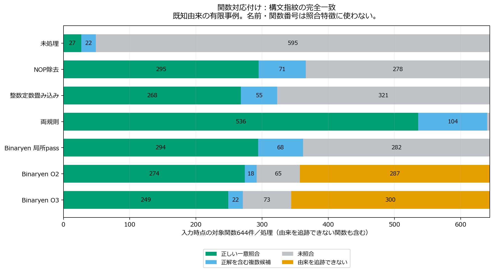
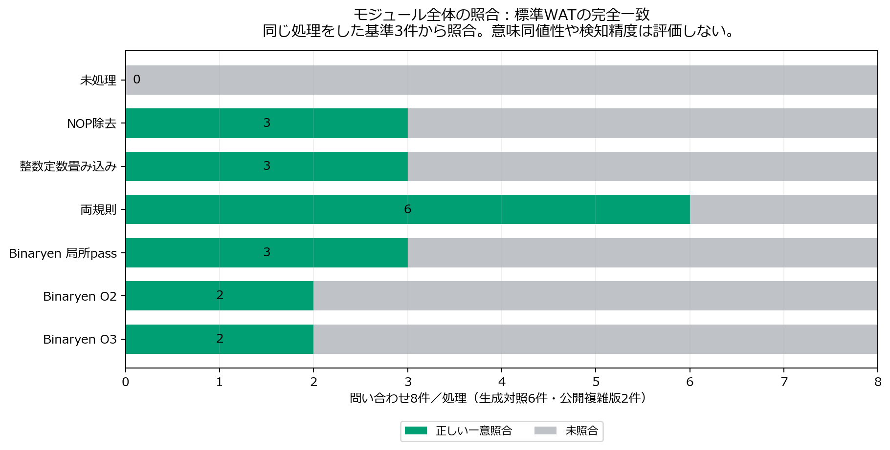

# 性能評価を踏まえたコード正規化の限定比較

2026年10月16日。全272ブロックの性能評価を終えた後、既存の局所規則とBinaryenを比較した。単純なNOP挿入・整数定数分割について、評価した入力の出力を保ちながら参照と同じ構文形へ整理できることを確認した。一方、公開された平坦化・命令置換のXOR補助関数は、今回の厳密な構文指紋では対応付かなかった。正規化モジュールの候補を検討する根拠であり、汎用的な難読化解除・意味同値性証明・検知改善の完成を示すものではない。

## 性能評価からの選定と既存成果

[追加性能評価](followup-performance-results-20261016.md)では、保存命令数と生成コード・速度が対応しないこと、頻繁に実行される16バイトXORを手動復元した対照で大きな速度差が生じることを確認した。このため、正規化では命令削減と高速化を同一視せず、構造の整理・計算結果・具体的な解析課題を分けて評価した。手動復元版と計数版は正規化の成功例に含めない。

既存のNOP除去と連続整数定数のadd/sub/mul/and/or/xorの畳み込みを、そのまま用いた。正規化器のSHAは `01af604b04e54026c9b53c5b70e6cb89ee9e8e2424890c28305b5bd62cad58d9` で、既存成果と一致する。通常の局所簡約であり、新しい難読化方式や新規な難読化解除アルゴリズムとは扱わない。

既存144静的条件・専用72条件・23バイナリ138回の正規化後速度・式解析・MINOSの結果と限界は保持する。今回、新しい正規化後のハッシュ速度測定は追加せず、以前の一貫した速度改善を確認できなかった結果を引き継ぐ。[既存成果の索引とSHA照合](../results/followup-evaluation-20261016/inherited-evidence-index.json)

## 比較条件と出力検証

対象は、今回同条件で生成した3実装の基準・NOP・定数分割の9件と、公開xmr-wasm平坦化・命令置換の2件、計11入力である。未処理、NOP除去、整数定数畳み込み、両規則、Binaryen133の局所pass（vacuum・precompute）、O2、O3の7条件、計77ラベルを評価した。基準版にも同じ処理を適用した。Binaryenの許可機能をそろえ、先行研究のO3指定を比較へ加えたが、過去の固定コミットの完全再現とは呼ばない。

行単位規則の入力では既存の関数末尾の表示アダプタを使い、再組立て後の標準WATが元と一致することを11入力すべてで確認した。77条件のWABT検証を通過し、出力は42種類のSHAに収束した。全77条件でexportされた関数の型、memory・table・globalの型と制限を照合した。局所規則33条件では、記録した全インターフェースと資源型が未処理と一致した。初期メモリ内容や全ホスト効果まで同じことを証明する監査ではない。

固定した76バイト入力について、新規状態・順方向・逆方向で計2,793照合が一致した。内訳は公表期待値945照合と、先に公表期待値を確認したwebminerpoolhashcnから導出したnonce変更入力1,848照合である。同じSHAの反復を独立の実装や独立の成功数に数えない。参照実装の共有由来と有限入力の限界を残す。

最初のxmr-wasmの大きなバッチは1GiB上限でOOM終了した。保存された957照合に出力不一致は記録されていないが、そのバッチを完了とは扱わない。成功・監査済みのSWAMPED21条件は再利用し、残りを各入力7処理ずつに分割した。バイナリ、入力、履歴順序、資源上限は変えず、全77条件を完了した。OOMの状態・計画・途中ログを保持している。[当初の失敗と改訂計画](../results/followup-evaluation-20261016/normalization-check-plans-v2.json)

再現手順の検証として、全11入力を7処理ずつの新規バッチでも再実行し、別枠の77条件・2,793照合が一致して監査を通過した。途中で見つかったWindowsの長い保存先パスによるコピー失敗は、当時のコードとログを保存し、計画の保存階層だけを浅くして解決した。この再実行は上記の主評価の標本数に加えない。[再現確認](../results/followup-evaluation-20261016/normalization-replays/172adcc0cd9b49aca166e490aaf62dfd/status.json)

[固定した評価条件](../results/followup-evaluation-20261016/normalization-plan.json)、[静的結果77条件](../results/followup-evaluation-20261016/normalization-static.json)、[出力・型・資源監査](../results/followup-evaluation-20261016/normalization-output-audit.json)、[実験プロトコル](followup-normalization-protocol-20261016.md)

## 関数対応付け

6件の生成対照の全定義関数640件と、公開平坦化・命令置換のXOR補助関数4件を対象とした。各処理条件で、同じ処理をした3基準モジュールの関数集合から構文指紋の完全一致で候補を探す。644件×7条件、計4,508問い合わせをすべて報告する。同じ3実装から得た相関の強い事例であり、644件の独立標本とはしない。

生成対照の対応関係は関数順序を保持する変換の由来から確認した。複雑な版は関数番号だけで全関数の対応を仮定せず、確認済みの8／16バイトXORに限定した。既存の平坦化の抽出検証に加え、命令置換版の該当するループと式を確認し、同じ698ケースを再利用した3実装の計2,094補助関数呼出しが一致した。これは採掘本体を読み込まない有限の関数テストで、全モジュール同値性ではない。[追加した補助関数の根拠](../results/followup-evaluation-20261016/normalization-helper-truth/manifest.json)、[有限テスト](../results/followup-evaluation-20261016/normalization-helper-truth/checks.json)

最適化後の由来を追うため、補助コピーのnameカスタムセクションだけに採点用の名前を付けた。77条件すべてで、補助コピーと実際の処理結果について全非カスタムセクションの内容の一致を確認した。指紋は実際の処理結果の標準WATから作り、採点名・関数名・関数番号・型の参照番号・コメントを除く。call等の関数参照先番号も照合特徴に使わない。型参照は型の構造へ置き換え、局所宣言・命令・その他の即値は保持する。ファイル名・family・由来は採点時にだけ使う。

| 処理 | 正しい一意照合 | 正解を含む複数候補 | 未照合 | 由来を追跡できない | 一意正答／644 |
|---|---:|---:|---:|---:|---:|
| 未処理 | 27 | 22 | 595 | 0 | 4.2% |
| NOP除去 | 295 | 71 | 278 | 0 | 45.8% |
| 整数定数畳み込み | 268 | 55 | 321 | 0 | 41.6% |
| 両規則 | 536 | 104 | 4 | 0 | 83.2% |
| Binaryen局所pass | 294 | 68 | 282 | 0 | 45.7% |
| Binaryen O2 | 274 | 18 | 65 | 287 | 42.5% |
| Binaryen O3 | 249 | 22 | 73 | 300 | 38.7% |

誤った一意照合と正解を含まない複数候補は、今回の全条件で0件だった。これを一般的な誤検知率や意味的な正確性に置き換えない。両規則では生成対照640件すべてで候補に正解を含み、うち536件は一意だった。参照集合には、呼出し先番号等を取り除いた指紋が同じになる関数が複数存在するため、104件の曖昧さが残った。公開複雑版の4関数は、全7条件で厳密指紋では照合できなかった。

大きい実装の関数数で結果が重み付けされるため、入力別の内訳も示す。次の「一意」は正しい一意照合、「複数」は正解を含む複数候補である。

| 問い合わせ | 関数数 | 未処理で一意 | 両規則で一意 | 両規則で複数 | 両規則で未照合 |
|---|---:|---:|---:|---:|---:|
| SWAMPED NOP | 30 | 0 | 30 | 0 | 0 |
| SWAMPED 定数分割 | 30 | 1 | 30 | 0 | 0 |
| xmr-wasm NOP | 221 | 0 | 171 | 50 | 0 |
| xmr-wasm 定数分割 | 221 | 20 | 171 | 50 | 0 |
| webminerpoolhashcn NOP | 69 | 0 | 67 | 2 | 0 |
| webminerpoolhashcn 定数分割 | 69 | 6 | 67 | 2 | 0 |
| 公開平坦化の補助関数 | 2 | 0 | 0 | 0 | 2 |
| 公開命令置換の補助関数 | 2 | 0 | 0 | 0 | 2 |

O2・O3ではそれぞれ287件・300件の問い合わせの由来を追跡できなかった。削除・統合・インライン化等と名前の追跡喪失を、この記録だけで完全には区別しない。追跡できた関数だけなら一意正答率はO2で274／357（76.8%）、O3で249／344（72.4%）となるが、644件を固定した結果と併記する。難しい対象が消えたことで高い正答率が得られたように扱わない。

## モジュール全体の照合と処理負担

補助課題として、生成対照6件と公開複雑版2件を、同処理した3基準モジュールから標準WATのSHAで照合した。計56問い合わせの一意正答は、未処理0／8、NOP除去3／8、整数定数畳み込み3／8、両規則6／8、局所pass3／8、O2・O3各2／8だった。両規則では生成対照6件が一致し、公開複雑版2件は全条件で一致しなかった。

この厳密一致課題は、元の命令列や関数境界を保つ処理に有利である。O2・O3は同じ計算を別の構造へ最適化し得るため、未照合や由来の喪失だけで正規化器・最適化器の一般的な優劣を決めない。関数やモジュールが一致しないことは、意味が異なることや最適化が失敗したことの証明でもない。

前処理では、手法の処理・出力、WABT検証、標準WAT生成を含む経過時間を1入力1回記録した。局所規則では入力の逆アセンブルと表示調整もこの区間に含む。共通の表示アダプタの検証、静的特徴・API監査、採点用コピーの生成は別に記録した。11入力での最小・中央値・最大は次のとおりで、反復測定による不確かさの推定ではない。

| 処理 | 最小 ms | 中央値 ms | 最大 ms |
|---|---:|---:|---:|
| 未処理 | 51.0 | 91.4 | 188.1 |
| NOP除去 | 146.6 | 314.2 | 771.1 |
| 整数定数畳み込み | 160.9 | 440.0 | 938.7 |
| 両規則 | 172.4 | 484.3 | 1006.3 |
| Binaryen局所pass | 82.1 | 202.1 | 308.1 |
| Binaryen O2 | 181.6 | 681.7 | 1208.1 |
| Binaryen O3 | 228.4 | 1017.2 | 3175.8 |

照合そのものの時間は指紋の辞書参照部分だけを計測し、入力前処理・特徴抽出・候補索引の構築・採点を含めていない。対象関数の残存数も手法によって異なる。小さい計測値から照合や解析全体の速度優位性を主張しない。人間の解析時間は測定していない。

[全関数指紋・採点用コピーの一致確認](../results/followup-evaluation-20261016/normalization-function-features.json)、[全4,508関数・56モジュールの照合結果](../results/followup-evaluation-20261016/normalization-matching-results.json)

## 正規化モジュールの可能性と開発課題

対象を限定した局所正規化は候補として成立する。今回の単純変換では、有限入力の出力を保持し、同処理した基準と同じ構文形へ戻せた。厳密な対応付け課題でも候補の回復を確認した。一方、複雑な式・状態遷移を持つ補助関数が参照と同じ構文形へ収束した証拠は得られていない。これらを不可能と結論せず、既存の式比較・状態モデル等の読み取り支援と併せて検討する。

開発時は次の点が必要になる。

1. ホストと有効入力を先に確定する。今回の固定76バイト入口のような契約を誤ると、正常な履歴依存を意味保存の失敗と混同する。
2. 原本・生成物・ツール版・規則と適用位置・SHAを保持する。正規化前の特徴を必要とする検知器や解析にも原本を渡せるようにする。
3. 副作用、メモリ、分岐、型、整数の幅を考慮して適用範囲を限定する。現在の規則の範囲を超える式の書換えには、別の検証が必要である。
4. 関数の統合・削除と対応付けの成否を区別する。由来を追えない対象と複数候補を隠さず、呼出し文脈等で曖昧さを調べる。
5. 頻繁に通る部位を優先して解析するが、正規化の有用性は命令数・速度だけで評価しない。構造の整理、有限入力の正当性、具体的な解析課題、前処理の負担を個別に測る。

既存研究の最適化・正規化・読み取り支援を置き換えたという結論にはしない。未知ファミリーへの適用、一般的な意味同値性、平坦化の自動解除、人間の解析容易性、検知性能は未評価・未達成の範囲として残す。既存のMINOS評価で不確かだった画素尺度や訓練重複も解消しておらず、検知改善を主張しない。
