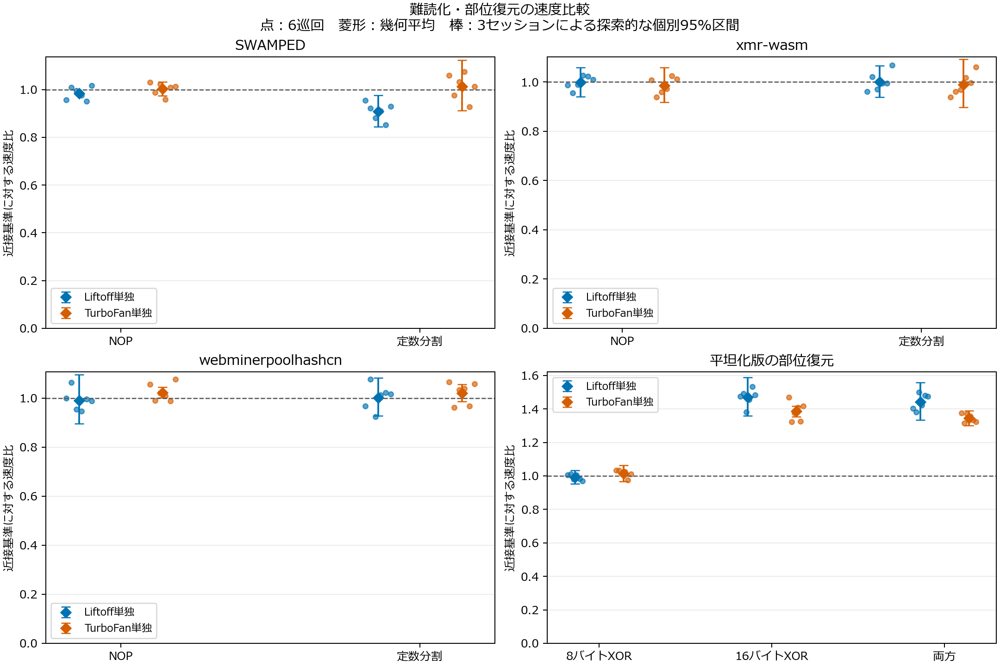
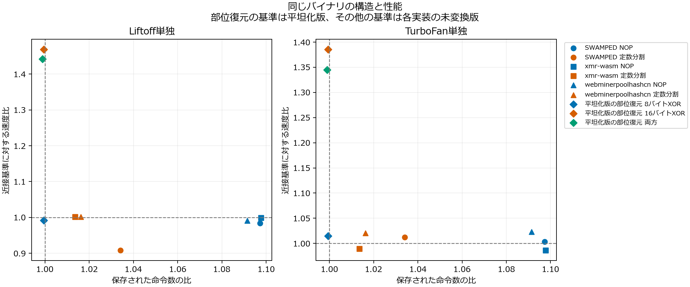
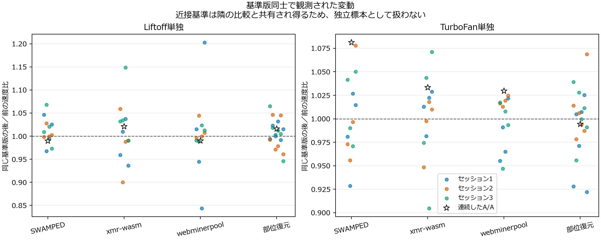

# 難読化前後の追加性能評価

2026年10月16日。性能評価・構造集計・呼出し箇所の診断は完了した。この結果を踏まえた [正規化比較](followup-normalization-results-20261016.md) と [統合報告](followup-research-report-20261016.md) も作成した。既存の論文・原本・結果・失敗履歴を保持し、追加結果を今回の条件の結果として報告する。

## 方法と監査

同条件で生成したSWAMPED・xmr-wasm・webminerpoolhashcnの基準・NOP・整数定数分割の9件と、公開平坦化版および同じモジュール内のXOR補助関数を手動復元した3件、計13バイナリを対象とした。3実装はCryptoNightの共有由来があり、独立した3アルゴリズムではない。部位復元は自動正規化の実装ではない。

同条件とは、保存済みバイナリに対するWAT往復、固定した変換・乱数・割合、検証ツールの条件を指す。元の3実装のC/C++ビルド条件をそろえて再ビルドしたものではない。公開バイナリの元のビルド差は残るため、各実装の基準版に対する変化を比較し、実装間の速度の絶対値から優劣を結論しない。

Node18.20.4／V8 10.2.154.26-node.37の固定イメージで、Liftoff単独とTurboFan単独、6巡回を連続する3セッションに分けた。各ブロックは新規プロセス、ウォームアップ5秒以上、計時30秒以上とし、変換版を近接した基準版で挟んだ。コンテナのネットワークnone・資源上限・非root・読み取り専用設定等をinspectで確認した。入力契約の調査を踏まえ、公表76バイト入力を用いた。

全272ブロックが終了コード0・OOMなしで完了し、3セッションとも厳密監査を通過した。Liftoffのみ136ブロック、TurboFanのみ136ブロックで、計時中のWasmコンパイルは全ブロックで0件だった。出力・nonce・計数とH/s・時間・資産SHA・隔離設定を照合した。JavaScriptホストのJIT等の全ランタイム処理を排除したという意味ではない。

速度比は前後の基準のH/sを計時中点で線形補間して求め、18種類×6巡回の108比較をすべて保持した。以下の速度比は6巡回の幾何平均である。図の区間は3セッションの平均対数比による探索的な個別95% t区間（自由度2）で、多重比較の補正はしていない。連続3セッションでは独立性や正規性を検証できず、一般環境での効果、同等性、確認的な有意差を主張しない。

[固定計画](../results/followup-evaluation-20261016/confirmatory-plans.json)、[全結果・各巡回・区間・CPU統計・生成コードサイズ](../results/followup-evaluation-20261016/confirmatory-summary.json)、[速度比較CSV](../results/followup-evaluation-20261016/confirmatory-summary.csv)、[同じ13件の静的集計](../results/followup-evaluation-20261016/confirmatory-structure.json)、[再現手順](followup-reproduction-20261016.md)

## 同条件で生成した変換の比較

すべて各実装の未変換版に対する比である。生成コードはV8が報告した `codesize` の合計で、未実行関数も含む。コンパイラの確保メモリ量、常駐メモリ、ネイティブ命令数、動的命令数とは異なる。26種類のバイナリ・コンパイラ条件で、観測した合計コードサイズの最小値と最大値は一致した。同じサイズでも同じ機械語を保証しない。

| 実装・変換 | 保存命令数比 | 生成コード比 Liftoff | 生成コード比 TurboFan | 速度比 Liftoff | 速度比 TurboFan |
|---|---:|---:|---:|---:|---:|
| SWAMPED NOP | 1.0973 | 1.0016 | 1.0000 | 0.9837 | 1.0035 |
| SWAMPED 定数分割 | 1.0341 | 1.0486 | 1.0009 | 0.9077 | 1.0121 |
| xmr-wasm NOP | 1.0977 | 1.0007 | 1.0000 | 0.9988 | 0.9859 |
| xmr-wasm 定数分割 | 1.0136 | 1.0123 | 1.0001 | 1.0014 | 0.9897 |
| webminerpoolhashcn NOP | 1.0914 | 1.0031 | 1.0000 | 0.9908 | 1.0228 |
| webminerpoolhashcn 定数分割 | 1.0162 | 1.0126 | 1.0018 | 1.0019 | 1.0202 |

NOPでは保存命令数が約9～10%増えたが、生成コードの増加はLiftoffで約0.07～0.31%、TurboFanでは報告サイズが基準版と一致した。対象版のNOP処理のソースは確認できていないため、個々のNOPがどの機械語へ変換されたかを説明したり、NOPの実行コストがゼロと断定したりしない。保存された命令数と生成コードサイズを区別する実測上の根拠として扱う。

SWAMPEDの定数分割はLiftoffで速度比0.9077となり、6巡回の比は0.8511～0.9554だった。TurboFanでは0.9273～1.0743と基準より速い回と遅い回があった。他の実装・条件へ一律の効果を一般化できない。コンパイラ条件による影響の違いを、構造と速度を対応付けて検討する必要がある。

## 実行部位と手動復元

次の基準は同じ公開平坦化版である。対象外の関数本文を保持して8バイトXOR、16バイトXOR、両方の本体を既存基準版へ戻した。3公表入力ずつの出力照合を先に通過している。

| 手動復元した部位 | 静的命令数の差 | 対応関数の1ハッシュ内呼出し | 速度比 Liftoff | 速度比 TurboFan |
|---|---:|---:|---:|---:|
| 8バイトXOR（f112） | −91 | 0 | 0.9922 | 1.0148 |
| 16バイトXOR（f118） | −91 | 1,179,648 | 1.4692 | 1.3857 |
| 両方 | −182 | 上記の合計 | 1.4426 | 1.3450 |

16バイトXORだけの復元は、静的命令数の約0.05%の削減に対し、今回の条件でLiftoff約46.9%、TurboFan約38.6%の速度増加に対応した。6巡回の比はそれぞれ1.3819～1.5327、1.3227～1.4690だった。生成コード全体の減少も約0.06～0.07%であり、総量だけではこの変化を説明できない。8バイトXORの復元では大きな一方向の変化は見られず、実行された部位の区別が解釈を補う。

呼出し箇所の計数では、基準・平坦化・命令置換の3版×3公表入力で、直接呼出しの総数が関数入口の1,179,648回と一致した。元の基準版では、主ループL17の直下2箇所が各524,288回、そのループ内の追加ブロックにある2箇所が0回、別のループの1箇所が131,072回だった。主ループ内の合計は1,048,576回である。回数から時間割合を推定しない。他の版では同じループ名の意味を仮定せず、箇所別の生カウンタを保持する。

集計器は当初、L17に含まれる全4箇所と直下2箇所を混同して停止した。静的レビューと全箇所のスコープを照合して分類を修正し、既存の実測・監査済みログを再集計した。計数用バイナリと実測値は変更せず、最初の失敗状態とstderrを保持した。[呼出し箇所の集計](../results/followup-evaluation-20261016/callsite-summary.json)、[復旧記録](../results/followup-evaluation-20261016/post-performance-recovery.json)

## 残る変動と解釈の限界

同じ基準版の前後比には0.8438～1.2029の変動が残った。近接基準の線形補間とWasmコンパイラ固定でも、任意の一時的な負荷やホスト条件の影響を除去できない。数%の差を一般的な改善や悪化と判断するには根拠が足りない。遅いブロックを事後除外せず、全値・セッション別の比・区間速度・CPU統計とともに提示する。

結論は、今回のバイナリ、有限の入力、ホスト、Node版、コンパイラ条件に限る。ゲストCPU0への指定はホスト物理コアの排他的使用ではない。計測は全ハッシュ呼出しの時間で、hash内部の初期化・解放を含む。生成コードの計測自体は[Cryptic Bytes](https://arxiv.org/html/2403.15197v1)にもあり、その手法を尊重して今回の入力・部位・コンパイラ条件との対応を補足する。

## 正規化の検討への接続

今回の結果は、命令削減を速度改善や解析容易性と同一視せず、意味保存・構造の整理・解析課題を分けて評価する理由になる。次の比較では、既存の局所規則を保持し、単純なNOP・定数分割と、頻繁に実行される複雑な平坦化・命令置換を分けて扱う。基準版にも同じ処理を適用し、既存Binaryen比較と先行研究のO3を含める。

元の計算結果へ戻せる範囲、既存最適化で同様に整理できる範囲、局所規則では残る構造を確認する。対応付け等の具体的な解析課題を評価し、結果を一般的な検知改善に置き換えない。手動復元の速度結果は、どの部位を解析する意義があるかを示す対照として用いる。
