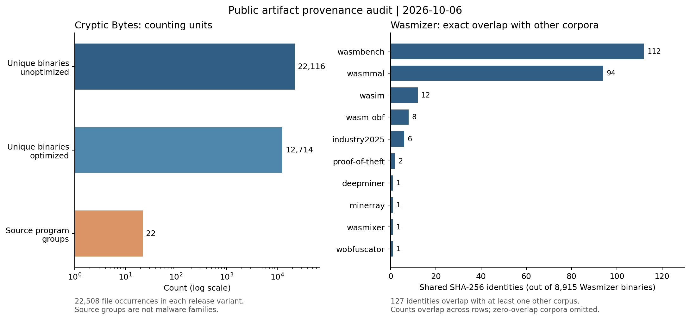

# 公開配布物の出典・生成履歴と重複の追加調査

調査基準日：2026-10-06。全体の命令・構造解析と配布物監査を完了した。本書は取得済み配布物の出典・生成履歴、バイト一致、解析失敗の偏りについて報告する。

## 取得範囲

最終的に固定したデータでは、18データセットIDと候補ファイル109,846件を管理する。109,844件でSHA-256を計算し、全体の重複を除くと70,564種類となった。解析成功67,729、逆アセンブル失敗10、検証失敗2,748、セクション解析失敗75、読み取り失敗2である。配布フォルダ内の件数は、実環境での独立した事例数ではない。

18データセットには、一般用途のコード、既知の変換を加えた対照用コード、ツールに同梱された例、著者が作成したAndroidのPoCも含まれる。マルウェアデータセットが18個あるという意味ではない。初期に抜き出したCryptic Bytesの24対照コピーは、後から取得した同じ配布物に含まれるため、別データセット・別の配布ファイルとして重複して数えない。

最新の取得件数は `results/corpus/acquisition-checkpoint.json`。命令解析の成功件数と混同しない。

## Cryptic Bytes：配布ファイル45,016件と元プログラム22本の対応

固定リリースの未最適化版と最適化版をそれぞれ全件取得した。

|単位|未最適化版|最適化版|両版の和集合|
|---|---:|---:|---:|
|配布ファイル数|22,508|22,508|45,016|
|異なるSHA-256の数|22,116|12,714|34,808|
|著者のソースプログラム数|22|22|22|

版を固定した著者のソースのファイル構成 `009e9e7bd812cbecacb506507e36834ae3ecddc4` の `dataset/games`、`dataset/utilities`、`dataset/miners` と配布パスを照合し、ゲーム6、ユーティリティ6、採掘実装10の対応を確認した。各版の22基準バイナリとすべての変換後のファイルを対応付け、最適化前後の同名対応に欠落はなかった。

これらは22種類の独立マルウェアファミリーではない。採掘実装であることと実際の悪性利用は別であり、同じ採掘アルゴリズムに関連するプログラム群も含む。`wasm-mutate`で生成したファイルが各版22,134件を占めるため、全件を一括で集計すると、この生成方法の影響が大きくなる。難読化の分布は、変換ごとのファイル数と、元プログラムを等しく扱う集計の両方で評価する必要がある。

ディレクトリの変換名と実測結果も分離した。未最適化LLVM群の1件、最適化wasm-mutate群の1件は、それぞれ同じ版の基準バイナリと完全一致した。その他のファイルも、バイトが異なるという理由だけで指定の変換が実際に加えられたとは判定していない。

証拠：`results/provenance/cryptic-bytes-parents.csv`、`cryptic-bytes-summary.json`。`scripts/audit_release_parents.py` で再生成できる。

## Wasmizer：公開版における重複の再検証

著者の[Figshare v2](https://doi.org/10.6084/m9.figshare.22264000.v2)を取得し、公開MD5 `3b201daa0589af5d0a90337819bbe360` と照合した。アーカイブのSHA-256は `f1c026c1a1077875a6f7bd15f2f835e5424a987d9a000617049b83bfa740ea16`。Wasmバイナリ8,915件を全件保存し、全件について名前に含まれるSHA-256と実際のバイト列との一致を確認した。別の1,384 WATは、取得済みバイナリ件数には加えない。

今回の取得範囲では、8,915件中127件が少なくとも1つの他のデータセットに含まれていた。

|比較先|完全一致したSHA-256数|
|---|---:|
|WasmBench filtered v1.0|112|
|WasmMal|94|
|WASimの同梱例|12|
|Cryptic Bytesのリポジトリ・リリース|8|
|Industry2025|6|
|Proof-of-Theft|2|
|deepMiner、MinerRay、WASMixer、Wobfuscator|各1|

行どうしにも重複があるため合計できない。WasmMalと共通の94件は、今回確認した著者ディレクトリラベルではすべて `benign` 群だった。共通バイナリがあることだけで悪性と結論付けない。

WasmBenchとの112件については、共通の保存オブジェクトを再利用するだけでなく、WasmBench配布物から展開したコピーとWasmizer ZIP内のコピーを別々に読み直した。全112件でSHA-256とバイト列が一致し、照合失敗は0件だった。対象サイズは56～5,199,336 bytesで、合計31,104,435 bytesだった。証拠は `wasmizer-wasmbench-overlap.csv` に元の配布パスと両アーカイブのハッシュを含めて保存した。

[Wasmizer論文](https://qstievenart.gitlab.io/pdfs/msr2023.pdf) §III-A-4 は2020年に構築されたHilbigらのデータセットとの重複がないと報告している。一方、今回取得したWasmBench filtered v1.0の公開メタデータは2020-12-01公開、Figshare v2は2023-03-13公開を示す。今回使った公開版の組み合わせでは、重複があることを確認できる。ただし、論文で実際に使った配布物と比較手順まで復元できたわけではない。原因を断定せず、配布版と照合方法を固定する必要性を示す観測として扱う。

## 比較群の構成と日時の限界

Wasmizerの `.meta` は8,915件すべてに存在した。出典パスには571種類のプロジェクトフォルダ識別子があり、678バイナリは複数フォルダに現れた。フォルダ名からGitHubの所有者・リポジトリを曖昧なハイフン分割で推定していない。571フォルダというメタデータ上の実測値を、論文の572リポジトリと同じ単位だとは決めつけない。

パスに `test*`、`fixture*`、`spec` の成分があるものは6,593件、`third_party`、`dependencies`、`_deps`、`node_modules` の成分があるものは4,960件、WATを指す出典を持つものは263件だった。同じファイルが、これらのパスの条件を複数満たす場合がある。ファイルの目的、良性かどうか、生成元を完全に確定する分類ではない。比較グループの構成を確認するために記録する。

著者のREADMEでは2022年12月に収集したデータと説明されているが、`.meta` から個々の実環境観測日は得られなかった。WasmBenchのリリース同梱メタデータは取得した8,460 SHAすべてに対応し、13,340出典レコードに観測日・収集日のフィールドはなかった。Git配布のJSONと内容全体は同一でないため、日時監査にはリリース同梱版を使用した。結果と入力ハッシュは `observation-dates-partial.json` に残した。この2データセットの公開日を時系列トレンドの軸には使わない。他のデータセットを含む日時監査は継続する。

この図は出典・生成履歴・重複の監査結果であり、難読化率を示さない。全体で難読化候補がどのように分布するか、元プログラムによる重み付け後の分布、解析失敗による偏りの評価は、実行中の解析結果を統合してから報告する。

## Wasmizerの解析失敗と出典パス

最終キャッシュ監査では、Wasmizer 8,915 SHAを全件試行し、6,221成功、2,694失敗、未処理0だった。失敗内訳と各入力キャッシュのハッシュを機械可読な監査結果に保存した。

|出典パス上の指標|全SHA数|解析試行数|失敗数|試行済みでの失敗割合|
|---|---:|---:|---:|---:|
|test / fixture / spec成分あり|6,593|6,593|2,687|40.76%|
|上記成分なし|2,322|2,322|7|0.30%|
|依存物を示す成分あり|4,960|4,960|2,639|53.21%|
|依存物を示す成分なし|3,955|3,955|55|1.39%|

指標は同じバイナリに紐づくいずれかの出典パスに該当成分があるかで判定する。テストと依存物の区分は重なるため、表の4行を合算しない。失敗は本実験のWABT・解析器の設定における失敗であり、全Wasm仕様で不正だという意味ではない。

ファイル名・パス成分に`invalid`を持つ122 SHAでは120件が検証失敗、2件が解析成功だった。名前が示す期待動作の正解ラベルまでは調べていないため、すべてを「意図的に不正な形式にしたテストファイル」と確定しない。一方、失敗が出典パスの性質と強く関連することは実測でき、解析成功だけで比較するとこのデータセットの構成が変わることに注意が必要である。

測定コードは`audit_wasmizer_failures.py`、全件CSVと入力キャッシュのSHA、層別集計は`results/provenance/wasmizer-analysis-status.csv`、`wasmizer-analysis-inputs.jsonl`、`wasmizer-failure-summary.json`。全体解析完了後の8,915 SHAを反映済みである。

## Cryptic Bytes：元プログラムを同じ重みで集計した場合の特徴の違い

配布ファイル45,016件をすべて著者パス上の基準バイナリへ対応付け、全件の静的特徴を比較できた。wasm-mutateは各版で約22,134件を占めるため、元プログラム内の中央値を先に計算し、その後に22プログラムを均等に扱った。

未最適化版の採掘実装10本では、基準に対する命令数の中央値比はLLVM群1.089、Tigress群1.474、wasm-mutate群1.395だった。最適化版では順に1.060、1.401、1.350だった。未最適化版wasm-mutateではゲーム、採掘実装、ユーティリティのnop増分平均が元プログラムを同じ重みで平均した後も47.7～49.2命令だったが、最適化版ではほぼ0だった。変換名やファイル数だけでは、特徴がどの程度変わったかを表せない。集計では最適化段階も分ける必要がある。

この比較は著者の変換ディレクトリを再現したもので、悪性利用や、変換前後で動作が同じであることを独立に証明するものではない。証拠は results/provenance/cryptic-bytes-feature-pairs.csv、cryptic-bytes-program-features.csv、cryptic-bytes-feature-summary.csv に保存した。

## MineSweeper：54.9 GBクロールTARの全件監査

公開TAR 54,914,109,440 bytesのSHA-256と公開MD5を照合し、アーカイブ内の572,485ファイルを、展開せずに順に調べた。349サイトのディレクトリに、Wasm本体の識別用バイト列を持つファイルが4,429件あった。ただし、異なるSHA-256は36種類だけであった。334サイトは1 SHA、15サイトは2 SHAを含み、最多の1 SHAは1,127箇所に現れた。

36 SHAはすべて本解析器でセクション解析に失敗し、WABT 1.0.42でも検証に失敗した。論文が報告する1,735 Wasm利用サイトは動的調査の単位であり、本監査の349サイトはTAR内に直接保存されたファイルで、Wasm本体の識別用バイト列を確認できた範囲である。両者を同じ分母として再現率を計算しない。証拠は results/provenance/minesweeper-crawled-summary.json と minesweeper-crawled-hashes.csv に保存した。

