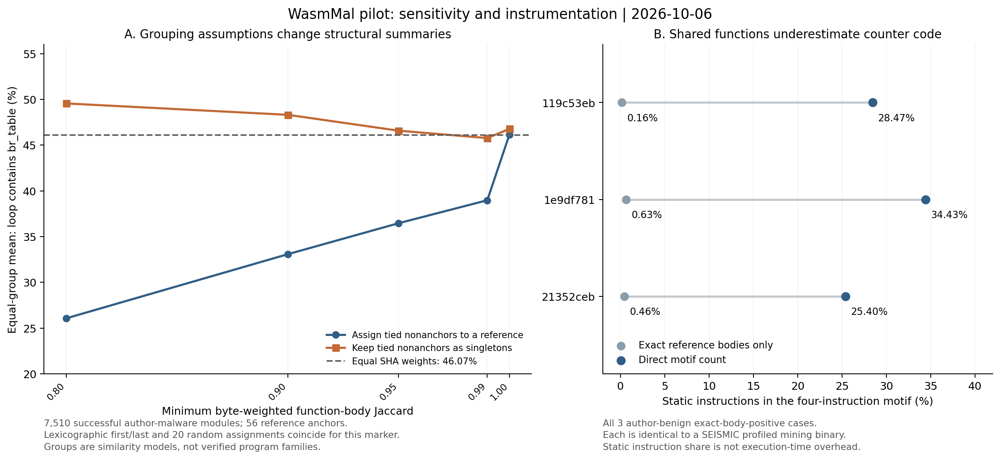
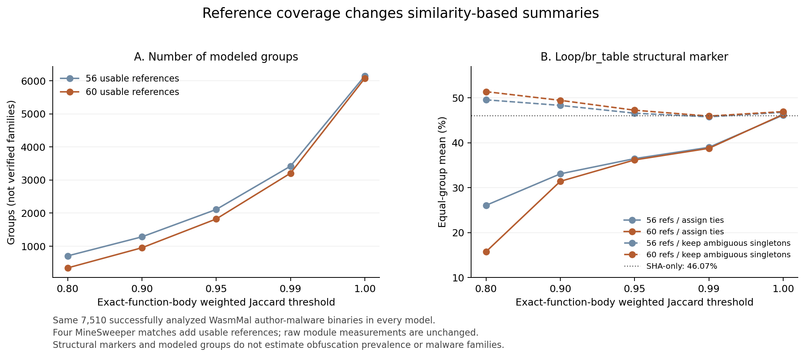

# WasmMal全件のコード構造の集計・類似度に基づく集計条件の比較・計測コードの追跡

2026-10-06。WasmMal公開版の15,024種類を解析した結果である。ここでいう全件とはWasmMalのルートにある`malware/`と`benign/`の和集合を指し、取得済み16データセット全体の命令解析完了を意味しない。

## 今回の結論

WasmMalでは、コードの特徴が見られる割合を、そのまま難読化の割合とは解釈できない。また、関数が似ていることだけでは、どのファイルから生成されたかを確定できない。ループ内分岐表の割合はSHA単位では46.07%だが、類似度0.80以上のファイルを参照ファイルごとにまとめ、各グループ内の割合を同じ重みで平均すると26.06%になる。一方、同点の参照先が複数あるファイルを個別に残すと49.55%となる。したがって「重複・生成を補正すると割合が下がる」という方向まで、今回のモデルだけでは確定できない。

別の集計では、計測用カウンタを含む関数との完全一致を悪性ラベル121種類・良性ラベル3種類に確認した。良性ラベルの3件はすべて、計測処理を加えたSEISMICの配布ファイルとモジュール全体が一致する。公開データセットには計測のために変換されたバイナリも含まれ、命令の増加を難読化の冗長コードと一括して扱えない。



## 対象と解析状態

|著者が付けたラベル|SHA-256の種類数|解析成功|失敗|
|---|---:|---:|---|
|malware|7,512|7,510|OSの読み取り失敗2|
|benign|7,512|7,510|WABT検証失敗2|
|合計|15,024|15,020|4|

著者が付けたラベルを保持し、採掘機能だけで悪性・良性を再判定していない。同じバイト列のファイルがtrain/testの両方にあっても、この表では別のファイルとして数えない。特徴量の割合は解析成功を分母とし、欠測するデータセクションのエントロピーには別の分母を用いる。OSの保護設定を変えて読み取りを試みてはいない。

|構造指標|malware：該当数／確認できた数|benign：該当数／確認できた数|
|---|---:|---:|
|nameセクションなし|6,732 / 7,510（89.64%）|5,768 / 7,510（76.80%）|
|`br_table`あり|7,426 / 7,510（98.88%）|4,329 / 7,510（57.64%）|
|構文上のloop内に`br_table`あり|3,460 / 7,510（46.07%）|3,963 / 7,510（52.77%）|
|`nop`あり|4,474 / 7,510（59.57%）|1,522 / 7,510（20.27%）|
|データセクションのエントロピー ≥ 7 bits/byte|6,788 / 7,131（95.19%）|222 / 6,973（3.18%）|

これは公開版内の構造差であり、難読化率・マルウェア検出精度・実世界の出現率ではない。エントロピーはシリアライズされたデータセクション全体を測るため、セグメント情報も含み、暗号化された文字列の比率ではない。エントロピーが高い理由には暗号計算や圧縮などが考えられる。また、通常のビルドでも名前情報は削除されることがある。

## 関数本体の類似度に基づく集計条件の比較

WasmMalの悪性ラベルと、WasmBenchまたはSWAMPEDの実験に使った元ファイルの完全一致を参照候補とした。57種類のうち1種類は読み取り不能のため、利用できる参照ファイルは56種類である。これは確認できた生成元のファイルの数ではない。

各関数本体のバイト列をSHA-256へ変換し、本体の長さを重みとする多重集合のJaccard類似度を使った。同じ本体が複数回出る場合も数を保持する。共有部分は各本体の出現回数の最小値×本体長、和集合の大きさは、両モジュールの関数本体の総バイト数から共有部分のバイト数を引いた値である。本体にはローカル変数宣言を含むが、imports、globals、データ領域等を含まない。空の本体集合の一致は生成元を判断する根拠とせず0とした。

参照ファイル同士はまとめず、それぞれ別の基準ファイルとして扱う。それ以外は最も高い類似度を持つ参照ファイルのグループに入れ、しきい値未満のファイルは1件だけのグループとする。まず各グループ内で指標の平均を求め、次に各グループの平均を同じ重みで平均した。欠測を「特徴なし」とは扱わず、測定値があるグループを分母にする。

|しきい値|参照にまとめる場合のグループ数|ループ内分岐表がある割合のグループ間平均|同点の非参照ファイルを個別に残す場合のグループ数|同・グループ間平均|
|---|---:|---:|---:|---:|
|SHA単位|7,510|46.07%|7,510|46.07%|
|0.80|706|26.06%|3,134|49.55%|
|0.90|1,282|33.07%|3,430|48.31%|
|0.95|2,109|36.46%|3,927|46.58%|
|0.99|3,418|38.97%|4,794|45.77%|
|1.00|6,144|46.16%|6,627|46.78%|

しきい値0.80では6,860種類が参照に割り当て可能だが、うち参照自身を除く2,428種類には最高点の参照が複数ある。参照先をSHAの辞書順先頭・末尾・20通りの固定乱数で選び直した場合、この表のループ内分岐表の平均は同じだった。一方、参照先が一意に決まらないファイルをまとめるかどうかで表の結果が変わる。この一致を他の指標にも一般化しない。乱数20通りの範囲は信頼区間や全割当ての上下限ではない。

しきい値1.00でも一致するのは関数本体の多重集合であり、コード以外や関数の順序を含む完全なモジュール一致ではない。通常の共通ライブラリも類似度を上げうる。確認できた元プログラム単位の集計と、ここでの仮定に基づく集計は分けて報告する。

## 計測コードの追跡

第1段階で確認済みの`aafff587…`を参照にした。global 11～15に対する`global.get g; i64.const 1; i64.add; global.set g`の連続4命令を対象とする。参照ファイルでは、この命令パターンが4,051箇所・42関数にあり、SEISMICの公開変換スクリプトと整合する。[第1段階の根拠](case-study-findings.md)

まず、この命令パターンを含む参照関数と本体のバイト列が完全一致する関数を、WasmMalの解析成功15,020種類から検索した。一致が見つかった割合は、悪性ラベルで121/7,510、良性ラベルで3/7,510だった。関数が少しでも変わると検索から漏れるので、この件数を計測処理を加えたバイナリ全体の数としない。

次に一致が見つかった124種類すべてを再度静的に逆アセンブルし、同じ4命令列をモジュール全体で数えた。124件すべてで検査に成功した。悪性ラベル121件では4,050～4,079箇所、静的命令総数に占める割合は34.35～34.47%だった。下位の値を取得する5種類の名前付きgetterの命令形がすべて一致するのは122/124件、5変数を0へ戻す名前付きresetの命令形が一致するのは124/124件である。

getterの厳密一致から外れた2件も保存した。`a783d92e…`のANDカウンタgetterには同じ値同士のORと0ビットの右シフトが、`ff8a6a34…`のXORカウンタgetterには2個の`nop`が挿入されていた。局所的に値を変えない処理と計測コードが同じファイルで共存している。したがって「計測用だから難読化はない」という二者択一のラベルにもできない。

|良性ラベルのSHA先頭|完全一致するSEISMICの公開ファイルのパス|参照と同じ関数内の命令パターン数|モジュール全体の命令パターン数|全体の静的命令に占める割合|
|---|---|---:|---:|---:|
|119c53ebaf60|NFWebMiner/webminer_v1.base_profiled.wasm|27|4,773|28.47%|
|1e9df781a23d|YetAnotherZECMiner/static/jazecminer.base.profiled.wasm|29|1,579|34.43%|
|21352ceb69d1|HushWebMiner/static/hushminer.base.profiled.wasm等|29|1,594|25.40%|

この3種類はWasmBenchにも完全一致する。元の採掘ソフトの配布・計測と、悪性の利用状況は区別する。WasmMalのラベル誤りと断定していない。グローバルの型と0初期値、getter、reset、スタック操作やメモリ操作中の更新箇所を個別に確認した。全命令の集計は補助プログラムによるもので、全命令を人間が監査したわけではない。

## 個別確認と再現

第3段階は、一致が見つかった良性ラベルの3種類すべてと、確認済みの参照例を除く悪性120種類から乱数シード20261008を固定して選んだ1種類である。選定と判定はそれぞれ`experiments/review-selection-stage3.json`、`results/cases/review-decisions-stage3.json`に記録した。正式な個別レビューの対象は、第1～3段階を合わせて35種類である。担当はCodexであり、独立した人間の確認は未実施である。選んだ事例だけから母集団の割合を推定しない。

WasmMal全件と参照ファイルの解析キャッシュを用意した後、次で再現する。

```powershell
.venv\Scripts\python.exe scripts\analyze_malware_sensitivity.py
.venv\Scripts\python.exe scripts\audit_similarity_ties.py
.venv\Scripts\python.exe scripts\prepare_counter_reviews.py
.venv\Scripts\python.exe scripts\audit_counter_cohort.py
.venv\Scripts\python.exe scripts\audit_case_reviews.py
.venv\Scripts\python.exe scripts\plot_malware_sensitivity.py
.venv\Scripts\python.exe scripts\verify_sensitivity_outputs.py
```

機械可読結果は`results/sensitivity/`に保存。全15,024種類の状態・特徴・類似度は`wasmmal-module-audit.csv`、116通りの集計行は`tie-sensitivity.csv`、一致が見つかった124種類を直接数えた結果とgetter例外は`counter-cohort-direct.csv`を参照。入力キャッシュやCSVのSHA、乱数条件も記録した。個別判定の参照オフセットと関数番号の存在を検査したが、この検査は判断内容の独立した正しさを保証するものではない。

## 研究上の位置付け

### MineSweeperを参照ファイルに追加した場合の集計結果

追加取得した、コミットを固定したMineSweeperのリポジトリには38 SHAがあり、すべてWasmMalにも存在した。著者ディレクトリの採掘34・良性4に対し、WasmMal側のラベルはそれぞれ悪性34・良性4だった。うち1 SHAは取得時のバイト列からハッシュを計算できたものの、ローカル保存後の読み取りが失敗しており、解析成功には数えない。採掘という機能だけで悪性ラベルの正しさを独立に確認したわけではない。

従来のWasmBench＋SWAMPED参照にはなかった悪性ラベル4 SHAが見つかったため、参照集合を57から61 SHA、利用できる参照を56から60 SHAへ広げて全15,024 SHAを再集計した。計測対象の集合と参照関係以外の測定値はすべて一致した。旧結果は`results/sensitivity/`、追加後は`results/sensitivity-minesweeper/`へ保存し、上書きしていない。なお、取得中の外部MineSweeper収集TARは、この追加参照モデルには含めていない。

|条件|56参照：グループ数|60参照：グループ数|56参照：ループ内分岐表がある割合のグループ間平均|60参照：同割合のグループ間平均|
|---|---:|---:|---:|---:|
|SHA単位のみ|7,510|7,510|46.07%|46.07%|
|類似度0.80、同点は辞書順先頭へ割当|706|343|26.06%|15.74%|
|類似度0.80、同点は個別保持|3,134|2,770|49.55%|51.37%|
|類似度0.95、同点は辞書順先頭へ割当|2,109|1,822|36.46%|36.17%|
|類似度1.00、同点は辞書順先頭へ割当|6,144|6,073|46.16%|46.30%|

各条件の入力は同じ解析成功の悪性ラベル7,510 SHAである。SHA単位の指標は3,460 / 7,510。グループ間平均は、まず各グループ内の割合を求め、次にそれらを同じ重みで平均した値であり、確定したマルウェアファミリー数・元ファイル数・難読化率ではない。最良類似度が変わったのは382 SHA、選択された参照SHAが変わったのは383 SHAだった。しきい値5通りと同点処理23通りの追加集計も保存した。



この結果は、重複・派生の補正を類似性から推定する際に、どの参照ファイルを用意できたかによっても結論が変わることを示す。グループ数が少なくなった集計方法を「正しい元ファイル数」と選ぶ根拠にはならない。完全一致の出典関係と、モデルによるグループ化を区別する必要がある。

以下のコマンドで再現する。

```powershell
.venv\Scripts\python.exe scripts/analyze_malware_sensitivity.py --include-minesweeper
.venv\Scripts\python.exe scripts/audit_similarity_ties.py --include-minesweeper
.venv\Scripts\python.exe scripts/compare_reference_expansion.py
.venv\Scripts\python.exe scripts/plot_reference_expansion.py
```

`reference-expansion-comparison.json`は全15,024 SHAについて参照関係以外の列が変わっていないことを検査し、入力CSVのSHAを記録する。比較図はPNG・SVG・PDFを生成し、PNGで文字・凡例の重なりがないことを確認した。

今回の集計では、公開データセットでコードの特徴が見られる割合は、グループのまとめ方によって変わった。また、著者が悪性・良性とした両方のグループで、計測用の変換が指標に大きく影響する例を確認した。計測コードと、局所的な冗長処理が共存する例もあった。これらを横断分析の測定方法と出典・生成履歴の確認へ組み込む。

難読化の時間的トレンドや実世界全体の比率は示せていない。全データセットの解析完了後、既知変換を施した対照群の元プログラム単位の集計、他のマルウェア関連配布物、失敗例の偏りと併せて解釈する。先行研究との差分は[比較表](literature-review.md)と照合し、「類似度を計算したこと」そのものを新規性としない。
