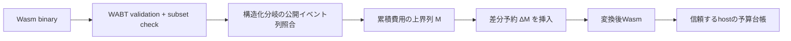

# 公開イベントの累積費用包絡によるfuel予約

状態: 限定Core Wasmで動作する研究候補。特許取得可能性は未判断。A/B/Cとは独立した、定量的な情報漏洩と資源受付の問題を扱う。

## 構成



公開イベント列が`e1,...,ek`で共通のコードを対象とする。経路pでイベントjまでに実行する元Wasm命令数を`C(p,j)`、最後の戻り値までを`C(p,k+1)`とする。marker引数の評価とcall命令も数える。ここでの命令費用は1の論理モデルであり、host marker本体の費用、meterの追加命令、実CPU費用を含まない。

`M[j] >= max_p C(p,j)`を得る。入口で`M[1]`を予約し、イベントj直後に`M[j+1]-M[j]`を追加予約する。累積上界は非減少なので差分は非負。予約残高が足りなければ、その時点で予算例外を発生させる。残った予約を秘密の実消費に応じて返金しない。

重要なのは、`ΔM[j]`は区間j単独の費用上界ではないこと。過去の未使用分を含めて累積で保証する。ある経路の区間費用が(90,10)、別経路が(10,90)なら、予約(90,10)でどちらも全体費用100以内に収まる。

## 合成規則

各構造の要約は`(event_word, prefix_bounds, segment_bounds)`。prefixは各event直後と構造末尾に対応し、最後の数値は構造全体の最大費用。segmentは比較対照のために独立して保持する。

```text
summary(atom): no events; [cost(atom)]
summary(mark(c)): events [c]; prefix [2,2]
summary(sequence A;B):
  events = events(A) ++ events(B)
  prefix = prefix(A) without final ++ [total(A)+x for x in prefix(B)]
summary(if cond then A else B):
  require events(A) == events(B)
  prefix[j] = cost(cond)+1+max(prefix(A)[j],prefix(B)[j])

rewrite:
  insert charge(prefix[0]) at entry
  at the j-th mark on every branch:
      execute mark
      charge(prefix[j+1]-prefix[j])
```

この規則は、分岐が複数eventをまたぐ場合の経路内の費用配分を保持する。一方、**別々のifの条件が相関することは推論しない**。したがって実行可能な全経路に対する厳密最小値とは限らない。

### 非巡回CFGへの拡張

`--acyclic`では、void block/if、値を運ばないbr/br_if、値を直接指定するreturnを解析する。各blockの直後をlabelの継続点とし、returnは関数出口へ接続する。全辺が小さい番号の節点へ向かうよう逆順で構築する。出口から各節点のevent suffixを求め、複数の後続節点のsuffixが一致しなければ拒否する。入口から累積費用と直前eventからの費用をそれぞれ最大値で伝播する。eventの順位は共通suffix長から求める。通常のDAG解析であり、新しいグラフアルゴリズムとは主張しない。

`--release-values`では`env.mark(id, value)`を許す。idは定数、valueは明示的に公開してよいi32式であり、評価費用も数える。元コードから同じ公開値列が生じる入力対について、予算が追加する観測差を調べる。任意のvalue公開を安全な秘密解禁として自動認定する機能ではない。

リンク時の未使用memory/global定義とexportは保存するが、アクセス命令は受理しない。確保・初期化・host内部費用はこの関数内費用モデルに含まれない。

## 条件付きの性質

1. accepted subsetは有限・非trap・非再入。host markerも同期非throwで、すべての経路のevent列が同じである。
2. 元のopcodeを実行する順序は変えず、meter callだけを挿入する。十分な予算では、元の戻り値とevent列が保存される。
3. 区間内の元費用は非減少であり、その区間末尾の累積費用はM以下。よって区間を開始できたなら、その区間全体を予約内で実行できる。
4. 予約の列とevent列は秘密値によらない。初期予算が同じなら、予算不足が発生するevent境界、残高の観測列が同じになる。
5. 返値と許可されたmarker payloadは元コードの明示的な出力であり、別途の非干渉は証明しない。実験では同じ公開出力になる入力対を区別して集計する。時間・cache・OS scheduler・untrusted hostからの保護は対象外。

これは紙上の帰納的論証であり、機械証明ではない。binary transformer、WABT、Node、host shimを信頼する。source hashとoutput hashは再現用の同一性情報であり、独立検査済みproof certificateではない。

## 既存方式との差分候補と限界

- SNIP-50、Sapphireの総量padding: gasを揃える基本目的は同じ。こちらは共通event列と途中の予算停止を明示し、累積上界をWasm構造から合成する。ただし両実装を攻撃したという結果ではない。
- 定資源型/AARA: 上界・potential・paddingの数学的基盤は強く近接する。未使用creditを持ち越す発想を新発見とは主張しない。
- 全関数予約: 安全性は同じく満たす強い対照。提案の差は、不足予算でも契約上許された公開prefixを実行できること。途中副作用を許さない用途では利点にならない。
- 手書きの累積schedule: 同じ性質を実現する。生成だけに特有の安全性はない。
- 予測に従い公開eventを遅延させるtiming mitigationも既知。fuelという資源軸への置換だけなら進歩性の主張は弱い。

## 請求項の技術的なたたき台

**F1（方法）**: WebAssemblyプログラムの資源予算に基づく実行を制御する方法であって、構造化制御構文の各分岐から公開される外部事象の列を導出し、分岐間で前記事象列が一致することを検査し、各事象の位置までの元命令列の累積費用の上界を合成し、隣接する前記累積上界の差を予約量として入口及び前記事象に続く位置へ予算検査を挿入し、先行区間で未消費の予約を返金せず後続区間の実行に充当することにより、入力の非公開部分によらず予算不足の停止境界を同じにする方法。

**F2**: F1において、分岐の累積上界を事象位置ごとの最大値で合成し、各区間の独立した最大費用の総和より小さい累積予約量を得る方法。

**F3**: F1において、事象列が異なる分岐、境界内の未解析call、trapを発生し得る命令又は有限上界を得られない構造を、当該予約方式の適用対象から除外する方法。

**F4**: F1において、予算不足の場合は次の事象間区間へ入る前に停止し、既に完了した公開事象のprefixを維持する方法。

上記は技術要素を検討するための文章であり、成立性・新規性・進歩性・権利範囲を確認した請求項ではない。一般のWCET受付や定資源解析で説明できる可能性が最大の弱点。

## 実験後の判断

初期7例は通常の前処理最適化で6例の分岐が消えた。途中計算値を一部公開する修正版ではWATとRust由来を含む3/8 pipelineを受理し、区間別最大値の和163/167に対し累積予約97/99を得た。ただし3 pipelineは同じ自作例である。全関数予約と手書き予約も同じ予算観測安全性を満たし、手書きより実行は約17～23%遅い。特許主案への昇格は保留する。[実測と限界](results.md)を参照。

## 修士研究としての範囲

週8–10時間を想定するなら、まず8–12週間でsubsetの形式化、独立checker、compiler由来コードへの適用率、複数runtimeの評価に絞る。loopやmemory・host effectの一般化は別段階。特許目的では先に「自作例以外の必要性」と近接研究の本文照合が必要である。
