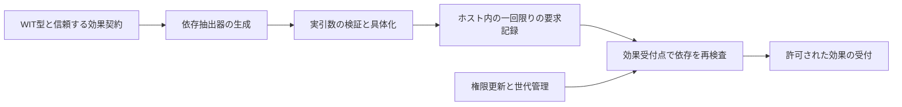

# 案A：実引数から生成する権限依存フェンス

位置づけ: 技術的な発明候補。失効の基本原理は既知。特許向けに残る中心は、型付き境界・効果契約から、過不足のない依存検査を生成し、特定の効果受付点へ固定する構成である。現時点で新規性・進歩性を確認したとはいえない。

追加実験後の第2設計は[単一処理計画の設計書](effect-plan-design.md)を参照。権限注釈とexecutorを分離する本ページの構成に対し、同じopcode列から依存と実行を導く試作を追加した。288条件が一致し、同じI/O executorを使う15 process比較で正しい手書き比約0.992～1.005だった。誤注釈・任意callbackの入力箇所を減らせたが、capability DSLとの近さから新規な特許と断言しない。

## 解決する問題と利用例

ファイル変換プラグインが書込み要求を出し、ホストが待機中にその書込み権限を失効させる。入口だけの認可では、古い要求が後から受け付けられる。一方、全プラグインの権限世代を一つにまとめると、無関係なファイルの権限変更やread権限の変更でもwrite要求を捨ててしまう。

狙う技術的効果は、**古い権限に基づく新しい効果受付を防ぎつつ、無関係な失効による拒否と再実行を減らすこと**。既に不可逆に受け付けたI/Oを取り消す保証ではない。

## 構成



1. 型定義からrecord・variant・option・list・resourceの位置を得る。操作に必要な権限は別の信頼する効果契約で明示する。WITの型だけで業務認可を推定しない。
2. 実際に選ばれたvariantと実引数を検証し、必要なresourceを具体化する。未選択variantの値を権限依存へ加えない。
3. 各依存を `(resource実体ID, table slot世代, 操作権限ID, 権限世代)` として記録する。aliasは実体に集約するが、slotの再利用は別に検出する。
4. 要求内容・送信先・依存集合をホスト側の不変な記録へ閉じ込める。guestに渡す整数IDは権限証明そのものではなく、所有者と世代を検査する索引である。
5. sink側で記録を一度だけ消費し、権限更新と直列化した受付処理内で依存を検査する。検査と実効果受付の間に待機や再入を挟まない。

権限が失効後に再付与されても、旧要求は自動復活させない。再認可を経た新しい記録を必要とする。streamは全体を一度認可するのでなく、契約で指定したchunk等の受付単位ごとに扱う（未実装）。

## 手順

```text
prepare(interface, arguments):
    values := validate_and_lift_once(arguments)
    obligations := generated_projection(interface, values, effect_contract)
    deps := resolve_identity_slot_and_permission_generations(obligations)
    require every dependency currently authorized
    return host_owned_ticket(frozen_effect, deps, unused=true)

accept_effect(ticket):
    atomically with relevant revocations:
        require ticket belongs to this caller and is unused
        consume ticket
        require every recorded slot and permission generation is current
        admit exactly the frozen effect

revoke(object, operation):
    atomically disable the grant and advance its operation generation
```

## 既存研究・特許との差分

- [root-scoped quiescence論文](https://arxiv.org/html/2609.21284v1)は、選択した権限依存と効果受付の扱いまで近い。依存する権限だけを失効させる発想は新規性の根拠にできない。
- [EP3493461A1](https://patents.google.com/patent/EP3493461A1/en)の請求項1–6には能力・失効情報・版と利用可否の関連付けがある。世代番号だけの請求では差が弱い。
- 狭い差分仮説は、**型の実際の選択枝とホストの効果契約から、alias／slot再利用／操作別の失効範囲を含む検査を自動生成し、その生成物を実効果受付点へ結び付けること**。この生成が既知のIDL wrapper生成と依存追跡の自然な組合せかどうかが最大の論点。

## 請求項のたたき台

**請求項A1（方法）**：WebAssemblyコンポーネントからホスト資源に対する処理要求を受け付ける情報処理方法であって、型付きインターフェース記述及び各操作が必要とする権限を示す効果契約を取得し、前記記述中の選択型の選択結果及び資源型の位置に対応する依存抽出処理を生成し、検証された実引数に前記依存抽出処理を適用して資源実体、資源索引の世代及び操作別権限の世代を含む依存記録を生成し、処理要求の効果内容と前記依存記録をホスト管理領域に固定し、当該効果の受付点において権限更新と直列化して前記依存記録を照合し、照合に成功した場合に限り前記固定した効果を一回受け付ける、情報処理方法。

**A2**：A1において、異なる資源索引が同一資源実体を参照するときは操作別権限の依存を共有し、各索引の世代の照合を別個に維持する方法。

**A3**：A1又はA2において、連続的な処理を効果契約で定めた複数の受付単位に分割し、各単位の受付前に依存記録を照合する方法。

**A4**：A1～A3において、未選択の選択型の枝にのみ含まれる資源、又は当該効果が要求しない操作権限の変更によって、前記依存記録を無効にしない方法。

これらは技術構成を検討する文章で、出願に適した権利範囲を確定したものではない。生成器と完全な効果契約の実施例がないままA1の範囲を支持したとは扱わない。

追試では限定WITからの依存抽出生成とローカルファイル受付まで実装したが、一般のWIT・host adapter・別threadや外部サービスを含むA1全体が完成したわけではない。

## 実装済みの部分と初期結果

Core Wasmの`request(tag,h0,h1)`とNodeホストで、左／右／両方を選ぶ3種類の要求を検査した。3×3のhandle組合せにaliasを含め、8種の更新イベントを適用した。raw/O3それぞれ216ケース。

|方式|不正な受付|不要な拒否|
|---|---:|---:|
|入口のみ|105|0|
|全体世代|0|84|
|資源全体の世代|0|27|
|操作別の具体的依存|0|0|

再利用された要求の二度目の受付、偽索引、不正tagは拒否した。この結果は選んだモデル内の比較であり、実WASIランタイムの欠陥の実証でも、WIT自動生成が完成した証拠でもない。現実装のtag→依存の選択は手書き。

### 限定WITからの生成追試

`fence.py`は1 interface・resource・record・variant・option/list・borrowから成る限定WITと、別ファイルの権限契約からJS抽出器を生成する。まずJco 1.27.0のwasm-toolsでWITを検証し、独自の限定readerは未対応構文を拒否する。WIT一般を網羅するparserではない。

read/write/copy/batch/optional/idleの6選択肢を、別に書いた手書きoracleと比較した。2,076要求の依存集合と、alias、操作別世代変更、slot再利用を含む20,760判定で不一致0。契約の欠落・余分なpath・未知の権限の3種を生成時に拒否し、6種の不正な実引数も拒否した。依存数0/1/8/64/1024/4096の抽出時間を記録したが、手書き実装への速度優位は主張しない。[実測](../../results/masters-security-20261024/fence-v1/results.json)。

この追試の値はhost側で持つslot/generationの模型で、Canonical ABIの生borrow索引ではない。borrowを呼出し終了後まで持ち越さず、host管理の実体ID・寿命・世代へ変換する必要がある。正式なComponentの呼出しから非同期受付点までつなぐ実装は未達。WIT検証用のdummy Wasmを作ったことを、全処理のend-to-end実証とは数えない。

### 実Componentへの接続追試（上記の未達部分を限定的に更新）

`component-fence.py`では、hostが公開するresourceをCore Wasmが所有し、Canon lowerを通してread/write/copy/list/option/idleのprepareを実際に呼ぶComponent binaryを作成した。Jco 1.27.0で展開し、同期呼出しが戻った後のJS継続から受付を行う。抽出器はhostのWeakMapで借用値を解決し、ticketにはhost所有の実体参照とコピーした整数だけを保持する。Jcoでoptionのnoneがundefinedになる点は、前の模型のnullと明示的に区別した。

rawとJco opt後の各1,089回、計2,178回のComponent prepareと受付判定は独立oracleと一致した。片方のslotだけの世代変更、実際のresource.drop、解放後のslot再利用、alias・read/write別失効、二重受付を含む。入口だけの対照は各402不正受付、全体epoch対照は各408不要拒否となった。これらは今回の固定シナリオ集合の件数で、実アプリケーションでの発生率ではない。[結果](../../results/masters-security-20261024/component-fence-v2/results.json)。

Componentは1,115 byte、最適化後999 byte、抽出JSは1,672 byte。生成・変換時間も保存した。正常シナリオ終了時の保有ticket・論理的な参照予約は0。ただし意図的なtrapの2種では資源の論理参照2件が残り、instance全体のteardownを検査していない。実資源の解放やRSSのゼロを証明した結果ではない。

この試験で境界を通る接続は実行できたが、受付先は同期のhost内ログである。OS I/O、別threadの失効、WASI全体、他runtimeでの一致は未検証。実Wasmの所有権規則を通したことと、外部サービスで効果の受付を原子化できることは分ける。新しい安全原理の確立という判断には更新しない。

### ローカルI/Oとinstance終了の追試

上記のOS I/O未検証部分は、[fence-file-v3](../../results/masters-security-20261024/fence-file-v3/results.json)で限定的に更新した。試験ディレクトリへ新規作成した3ファイルに対し、read/write/copy/batch/optionの288条件で、実際の内容と戻り値が独立oracleに一致した。拒否64条件では対象効果が発生せず、受付された効果はread 44回、write 312回。さらに6例の制御した失敗を記録した。closed FDのEBADF、実行中の再入した権限変更の拒否、先行書込み後のI/O失敗を区別する。最後の例では先行書込みが残る。受付時の認可は、複数操作のtransactionやrollbackを保証しない。

[fence-teardown-v2](../../results/masters-security-20261024/fence-teardown-v2/results.json)は、prepare後trapする派生Componentを追加し、60条件でhost所有のticket・論理参照を回収した。36例で意図した例外が発生し、shutdown後の論理参照とticketは0、試験FD180件のclosed状態をEBADFで確認した。二つのinstanceの一方だけを閉じる2条件も確認した。guestのreleaseをtrap後に呼び直さず、host ownerが後始末する。FDはこの試験のinstance専用で、共有backendの全破棄・非同期I/Oの中断・process crashの処理を検証したものではない。世代の周回は拒否し、終了処理は再実行しても二重返却しない。

### 別schemaで見つかった生成器の制約

固定6 variantに加え、kebab-caseのrecord field、二重option、optionのlistを使う別Componentを検査した。旧生成器はWITのfield名をJSへそのまま出し、全optionをundefinedで表すため失敗した。Jcoのfield名変換と、nullable/taggedを交互に使うoption表現へ修正し、[fence-shapes-v2](../../results/masters-security-20261024/fence-shapes-v2/results.json)の336呼出しで依存・受付が一致した。旧版の2種類の失敗も保存した。深さ1–4の14 JS表現をJco型宣言と照合したが、実際のABIを通したのは深さ2である。

改修後に元の模型20,760判定・実Component2,178判定・ファイル288条件を再実行した。同一条件の再実行を新規独立サンプルとして合算しない。最初のshape runnerはJcoのdirectory作成でEPERMとなり、実験未実行として[fence-shapes-v1](../../results/masters-security-20261024/fence-shapes-v1/commands.json)に保存した。directory事前作成後のv2が測定結果である。bindingの不備を直したこと自体は発明の根拠にしない。

### 正しい手書き方式とのコスト比較

4方式×5独立processで、同じComponentのsetup→prepare→JS継続→受付→releaseを測定した。生成した操作別方式の時間比は、手書きの操作別方式に対して9ケースで約1.014～1.124。生成器が高速な認可原理を発明した結果ではなく、型・shape検査等を含む追加コストである。別の54失効シナリオでは、生成／手書きの操作別方式は不正受付0・不要拒否0、実体全体方式の不要拒否11、全体方式31だった。[20 processの原表](../../results/masters-security-20261024/fence-performance-v1/report.md)。

list長64でも実体は2個を繰り返すため、64個の独立資源での性能と読み替えない。各processの同じ54シナリオを独立の新規シナリオとして合算しない。新たな差分仮説を支えるには、手書きadapterで起きる依存漏れを生成によって減らせるかを、現実的な型と明示的な誤実装モデルで測る必要がある。

この性能値はfence-performance-v1に保存された旧runtime・抽出器の値である。その後に追加したI/O、shutdown、binding修正の費用を測った値として流用しない。

改修版も同じ計画で20 processを測定し、[fence-performance-v2](../../results/masters-security-20261024/fence-performance-v2/report.md)の9ケースでは手書き比約0.960～1.081となった。認可判定の精度は同じ。I/Oは測定外であり、過去の測定との差をアルゴリズムの速度改善とは解釈しない。現時点では手書き方式に対する一貫した速度優位を示さない。

型からの抽出を手書きせず生成できるところまで進んだ一方、従来のIDL生成と権限依存の追跡を超える安全原理は未確認。既存`resource-trigger`研究はdestructorを計算に利用する難読化であり、本追試の新しい実験件数には含めていない。

## 修士研究での検証

週8–10時間、10–12週間を仮定した一案単独の見積り。最初の2週でWITの限定subsetと効果契約を固定、3–5週で生成器とWasmtimeへの一種類のhost adapter、6–8週で状態機械の有限検証と二つの実用プラグイン、残りで評価・執筆。

- 正当性：revoke／grant／close／reuse／acceptの全順序、重複要求、alias、variant、listを組み合わせる。認可oracleは抽出器と別に記述する。
- 効果：失効後の新規受付率、無関係な変更による拒否率、再実行回数。全体epochだけでなく、手書きの正確な依存集合と比較する。
- 性能：受付p50/p95/p99、依存数1/8/64/1024、ticketのlive memory、抽出器の生成時間、正常時throughput。生成器で手書き精度を維持できることを評価する。
- 失敗条件：hostの隠れた権限依存、外部サービスでの非原子的受付、世代の周回、所有者検査漏れ、未知の動的呼出し。完全性を証明できないものは追加注釈／保守的検査とする。

**最大のReject理由**：既存の権限依存・epoch検査をWIT wrapperにしただけで、手書きの正しい仲介器に対する新しい技術的効果がない。自動生成による漏れ削減を実データで示せなければ特許の主案にしない。

### 近接する生成器を読んだ後の修正

Omerの2025年修士論文のWacky/Shimmerは、WITと構成情報からアクセス制御shimの挿入・雛形生成を既に実装する。[読了範囲と照合](prior-art.md)。したがって「WITからセキュリティwrapperを生成する」は新規性から除外する。同論文が制約として挙げるresourceの仲介・寿命と、実行中の失効は、Aを試す具体的な研究課題になる。今回の限定Componentとhost所有台帳の追試は、その課題の一部を検査するものである。一般のresource proxy、任意の所有移動や別runtimeに対する解決は未達。
