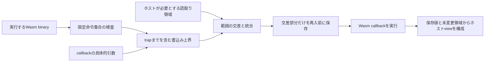

# 案B：再入の書込み上界から生成する部分スナップショット

3案中、まず修士研究として進める案。理由は検証対象を一つの境界に限定でき、解析器・正当性・性能を同じコードで評価できるため。特許性が高いと判定した意味ではない。部分コピーと静的checkpointは既知であり、狭い構成の差をこれから確かめる。

追試後の採否更新：第三者libraryでは保存量を減らせなかったため、現方式の用途を限定し、次の追加実装はAを優先する。[判断](decision.md)。Bの実装・反例・草稿は再現用に残す。

## 解決する問題

ホストがWasmのデータを検証した後、Wasmへcallbackし、戻った後で同じ場所を使うと、検証時とは別の値を読む可能性がある。全データのコピーは簡単だが、callbackが触るのが数byteだけでも大きなbufferを保持する。目標は、ホストが必要とする**再入直前の値**を保ちつつ、境界をまたいで保持するbyte数を減らすことである。

これはメモリ破壊全般の検出器ではない。検証前から不正な値であればホスト自身の検証が必要。Wasm中の任意のbuffer overflowを防ぐ方式でもない。

## 構成



前提は、信頼するホスト、単一の非共有linear memory、境界をまたぐ他の並行writerがないこと。ホストが使う範囲Rは再入前に確定・bounds検査する。pointerを含む動的な構造では、ポインタや長さの依存もRへ含め、その検証済みの構造を後からguest memoryだけで読み直さない。

callbackの任意の実行prefixが変更し得るbyteの上界をWとする。正常終了までの最終差分だけを解析すると、途中のstore後にtrapする場合を見落とすため不十分。

保護するのはホスト用viewであり、guestのmemoryを元へ戻すtransaction rollbackではない。callbackのreturn／trapという結果も別に保持する。試験ではtrap後のmemoryを観測するため例外をcatchしているが、実アプリケーションへの組込み時に既存の例外伝播を勝手に消してよいという意味ではない。

保存集合は`S = R ∩ W`。実行前memoryをM0、実行後／trap後をM1とすると、ホストviewは次になる。

```text
view[a] = saved[a] if a in S else M1[a]      (a in R)
```

Wが健全な上界なら、RのうちS以外には書込みがないので`M1[a]=M0[a]`。SはM0を保存してある。したがって、全a∈Rでview[a]=M0[a]。これは前提付きの簡単な論証で、Wを作る任意の解析器まで正しいと証明するものではない。

## Wasmに固有の検査

- `i32.add`によるアドレス計算は32bitで周回する。一方、load/storeのmemarg offsetは動的アドレスへ広い精度で加える。この二つを区別する。
- `memory.fill`／`memory.copy`の書込み先と長さを扱い、bulk命令がtrapしたときも前の命令の効果は残ると扱う。
- structured `if`は両枝の書込み上界を合併する。動的分岐条件を無根拠に推測しない。
- 最適化後の実binaryを再解析し、対象binaryのhash・entry・memory・引数規約に結果を結び付ける。hash一致だけで、信頼していない証拠の内容を正しいとはしない。
- 未知のhost importや未対応命令はR全体のコピーへ退避する。共有memoryはcopy中の並行変更も問題となるので、今回の契約では拒否する。

## 現在の擬似コードと実装範囲

```text
certify(wasm):
    validate binary
    reject shared-memory contract
    inspect complete callback body
    for store / fill / copy: derive conservative address-length expression
    for structured branch: union effects of both branches
    for unsupported effect: return FULL_COPY
    bind summary to bytes, export, memory, signature

invoke(arguments, read_ranges):
    validate and freeze arguments and read_ranges
    ranges := evaluate_checked_summary(arguments)
    saved := copy(memory, union(read_ranges intersect ranges))
    execute callback; retain its return or trap outcome
    expose the old-value view using saved and unchanged bytes
```

現試作は単一関数・3個のi32引数、store8/store16/store32、add/sub/and、if、fill/copyを解析する。未知のload由来アドレスは全コピー。一般のC/Rustプログラム、再帰、indirect call、shared memory、memory64、任意の動的構造を解析できる段階ではない。

## 先行技術との差と請求項

[RLBox](https://www.usenix.org/conference/usenixsecurity20/presentation/narayan)にはfield単位のfreezeがあり、[EP4343593B1](https://patents.google.com/patent/EP4343593B1/en)には信頼領域へのコピーによるcheck/useがある。[Lightweight Memory Checkpointing](https://download.vusec.net/papers/dsn-2015.pdf)には静的な書込み解析・不要な退避の削減がある。したがって「必要部分をコピー」「静的解析で削減」という広い主張は採らない。

差分仮説は、**実行binaryに結び付いたWasmのprefix効果検査とホストの読取り契約を用い、通常復帰・trap後に同じ旧値viewを生成する境界アダプタ**。既存checkpointをWasmへ移植しただけか、検査可能な安全条件と実用上の効果に追加の貢献があるかを反証する。

**請求項B1（方法、寿命条件を追試後に補足）**：ホストとWebAssemblyモジュールの間でデータを受け渡す情報処理方法であって、実行対象のWebAssemblyバイナリ及びホストから再入する関数の入口を取得し、当該関数の正常復帰又はtrapに至る実行prefixが変更し得る非共有線形メモリの書込み領域の上界を検査し、再入前に確定したホストの読取り領域と前記上界との交差領域を求め、当該交差領域の再入前の値をホスト管理領域へ退避し、当該関数の実行開始からホスト用アクセス処理の終了まで当該関数及びその呼出先以外からの当該メモリへの書込みを排除した状態で、前記関数の実行後に、退避した値及び前記読取り領域のうち交差領域以外の線形メモリの値を用いて、再入前の読取り値を提供する前記ホスト用アクセス処理を生成する、情報処理方法。

**B2**：B1において、32bit整数演算の周回とメモリ命令の静的offset加算を区別し、bulk memory命令の書込み上界を算出する方法。

**B3**：B1又はB2において、書込み上界を得られない効果が存在するときは前記読取り領域全体の退避を選択し、並行変更のない前提を満たさないメモリについては処理を拒否する方法。

**B4**：B1～B3において、最適化後のbinary、関数入口、メモリ識別及び引数規約に対する照合に成功した上界のみを使用する方法。

出願範囲の確定ではない。B1が既知の静的checkpointと同一／容易な構成と判断される可能性は残る。

## 実測と限界

9種×raw/O3=18 binary、各208入力、計3,744ケースでホストviewは再入前の値と一致した。うち466ケースはtrapを含む。コピーなしでは2,296ケースで値が変わった。

範囲を解析できた16 binaryの合計では、境界をまたいで保持したpayloadは18,746 byte、全Rをコピーする対照では13,631,488 byteだった。これは多数の小入力で合計した保存量で、ピークRSSや総メモリがその比率で減ったという意味ではない。未知loadの2 binaryは全コピーへ退避した。

全出力viewを生成する現試作では、復帰後にR全体を別bufferへmaterializeする。その費用も測っており、「総コピー量を99%以上減らした」「高速化が確立した」とは主張できない。1 process内の小さな測定で、順序・GCの影響も残る。`precomputed-same-ranges`は同じ範囲式を事前評価した対照であり、RLBoxそのものでも独立な最適手書き実装でもない。

別の有限モデルで6byteのR、W、実書込みsubsetと4パターンの元値を全列挙し、186,624照合が一致した。Wから1byteを落とすと失敗する反例と、WABTでstore後のtrapがstoreを取り消さない例も保存した。

### 追試：実際の再入と到達する関数の要約

`boundary.py`ではWasmの`drive`→host import→同一instanceの`callback`という実際の再入を構成した。callbackから到達する直接呼出しを引数代入して解析し、到達しないhost importは書込み効果へ含めない。到達する未知importは全コピー、再帰・indirect callは未対応として全コピーとする。O3後のinline・関数番号変更も実binaryから読み直す。

ホストは再入前に`length, pointer`のdescriptorを検証し、descriptorとpayloadを含む疎なRを確定する。callbackがpointerを書き換える例、別関数のstore、bulk copy、部分書込み後のtrap、alias、memory.growを検査した。7種類×raw/O3の14本、1,498ケースで旧値viewが一致し、232ケースはtrapだった。解析できた10本で境界をまたぐ保持payloadの合計は1,098,960→2,702 byte。未知importとgrowの4本は全コピー。追試は性能測定を行っていない。

[追試結果](../../results/masters-security-20261024/boundary-v1/results.json)と[監査](../../results/masters-security-20261024/boundary-audit-v1/audit.json)を保存。42ファイルのhash、14上界の再算出、隠れた値式内のstore・local変更・indirect call等の7回帰例を確認した。これで一般のComponent Model再入規則を実装したとは扱わない。

## 修士研究の実験計画

### 追試：Rustコンパイラ出力とconsumer

`compiler.py`で自作Rust処理8種を最適化0/2/s、さらにBinaryen O3の有無で48本にした。第三者の実アプリケーションではない。初期解析器は12/48本で部分退避を選び、36本は全コピー。分岐の移送先ごとにlocal環境を保持し、store値がunknownでも書込み先が分かれば受理する`effects.py`により、同じbinaryで28/48本へ改善した。残り20本はloop・値を返すcall・global.set等で全コピーとなる。同じ6,528入力で不一致0。受理した28本の保存payload合計は31,195,136→150,648 byteだった。

これは既知の抽象解釈の適用拡張であり、新しい解析原理の発明とは数えない。[健全性条件](soundness.md)に、branchを飛ぶlocal代入とstore引数の評価順を記載した。追加128本・8,960入力・308 trapで、観測できた13,240byteの変更がすべて上界に入った。等値storeを動的に列挙した検査ではない。

`consumer.py`ではRust最適化2の8例について、全コピー、部分退避＋全量materialize、部分退避＋区間読取り、別実装の手書き最小範囲を比較した。5反復×4方式=20独立process、100 warmup、300呼出し×9 batch。全8192byteのchecksumを同じ入力系列で計算する。区間読取りは全コピー時間比の中央値が例ごとに約0.75–1.23で、常に高速ではない。metadata例は約23%遅かった。全量materialize版は約1.00–1.46で、保存量が減っても速度を改善できない場合が明瞭になった。

区間読取りのviewは、consumerが終わるまで新たなwriterを許可しない契約が必要。任意の期間保持できるimmutable bufferと同じAPIではない。手書き対照に概ね近いが、loopでは解析器が全コピーのため手書きより保存量が多い。現在の自動生成が手書き最良方式を超えたとは主張しない。[性能原表](../../results/masters-security-20261024/consumer-v1/report.md)。

以上から、研究可能な適用範囲と失敗条件は具体化したが、**特許向けの新原理はまだ確立していないという判断は変わらない**。SafeFetch・Iris-Wasm・古いportable checkpoint公報を差分監査へ追加した。

### 第三者ライブラリでの否定的結果

hash-wasm 4.12.0の8種（Adler32、CRC32、MD5、SHA1、SHA256、SHA512、xxHash32、xxHash64）の公開済みWasmに薄い入口wrapperを追加し、Init/Update/Finalの3入口×raw/O3で48条件を作った。元の関数本体を変更していないことをraw側で照合した。1,680入力で旧stateのviewと元binaryの挙動が一致し、うち1,260件は別のdigest計算とも照合した。

しかし範囲解析はAdler32初期化の2条件だけで、残り46条件はloop、i64、unknown address等により全コピーとなった。保存payloadは**147,000 / 147,000 byteで削減0**。公開save()の対象stateは4～208byteで、全memoryを退避する弱い対照を使うと効果を過大評価する。既存save()は4byteのbinary識別子も保持し、長寿命の保存を提供するため、今回の短命viewとのAPIの違いにも注意する。

[固定計画](library-plan.md)、[48条件の表](../../results/masters-security-20261024/library-v1/report.md)、[実測](../../results/masters-security-20261024/library-v1/results.json)を保存した。これは第三者libraryを研究harnessから呼んだ試験であり、実アプリケーションへ組み込んだ評価ではない。この結果を受け、現解析器のまま一般的なライブラリへのコピー削減を主張しない。反証された用途に速度反復を増やして有意差を探すこともしない。

### 独立したbytecode経路による要約の確認

`byte-checker.py`はWAT readerや`effects.py`を呼ばず、binaryのcode sectionとoperand stackから書込み式を別に導出する。標準validation済みの224本を対象とし、提示された98個の部分要約はすべて一致、126個は全コピーとして分類した。上界の削除・offset/lengthの変更・不正な式という501件の構造改変と、224件の別hashを拒否した。[監査](../../results/masters-security-20261024/checker-audit-v1/audit.json)。改変の拒否は各改変が意味論的に不健全である証明ではなく、同値だが構造の違う式も拒否し得る。

checkerは207行、元の解析器は136行で、trusted codeを小さくできたとはいえない。検査時間の中央値は当該小例で約0.107msだが、単回測定で大規模性能の主張ではない。標準validation・host前提と両実装の正しさには依存する。機械検証済み証明やPCCの新原理としては扱わない。`check-certificate.py`は入力を一度読み、そのbyte列をvalidation・hash・別解析へ渡すCLIを提供する。

### 追試：計算移動という強い対照と、適用するAPIの切分け

checksumをcallback前に計算して結果のみ保持する`hoisted`を追加すると、全コピー時間比は例ごと約0.46–0.79となり、区間consumerと同等又は速かった。このconsumerだけでBの必要性を示す仮説は支持されない。`consumer-v2`はv1の結果を見て追加した対照である。

一方、callback後にcallerが読取り位置を渡す旧値view契約を別に実装した。全コピー対照にも余計な全buffer checksumを課さず、各方式16個のbyte値を返す。20 processで、範囲解析できた7例の時間比は全コピーの約0.41–0.73、loopで全コピーへ退避する例は約1.12だった。任意位置の旧値は4byte checksumから供給できないが、位置が事前に分かる用途ではその位置だけの退避が有力。この試験も自作microbenchmarkであり、実アプリケーションで前倒しできない必要性を確認したわけではない。[query実測](../../results/masters-security-20261024/query-v1/report.md)。

契約の反例として、consumer前の別writer、保存時と実行時の引数変更、別binaryの要約流用を実行し、3例とも旧値が壊れた。binary hashが一致していても、書込み集合を偽造した証拠は再解析と一致しない。これらは既存製品の脆弱性発見ではなく、方式の必要条件の検査である。[契約監査](../../results/masters-security-20261024/contract-audit-v1/audit.json)。

週8–10時間、12週間程度。一度にこの案を主題とし、他2案は比較資料に留める。

1. 1–2週：契約・脅威モデル・近接特許を固定。安全なホスト処理の例を2つ選ぶ。
2. 3–5週：複数関数のcall summary、上界の独立checker、受理／全コピー／拒否の分類を実装。
3. 6–7週：画像メタデータのcallback、parser/pluginのhook等、2種類の実コードで測る。新規脆弱性の探索を必須成果にしない。
4. 8–9週：全コピー、手書きの最小snapshot、RLBox相当のfield freeze、write barrier対照を同条件で測定。
5. 10–12週：反例・アブレーション・執筆。安全性は前提付き論証、測定は中央値とばらつきで提示。

主要指標は未退避の実書込み0件、旧値viewの一致、範囲解析のcoverage、保存byte、生成／検査時間、呼出しlatency、peak live bytes。除去実験はprefix効果、alias統合、binary再照合、保守的fallbackをそれぞれ外す。未知を安全と扱う速度改善は採用しない。

**最大のReject理由**：静的checkpointの既知最適化をWasmに当てただけで、狭い人工例以外は全コピーになる。2種の実コードで有用なcoverageを示せず、手書き対照と同等の安全性を自動で実現する価値も示せなければ、主題を縮小又は撤回する。
