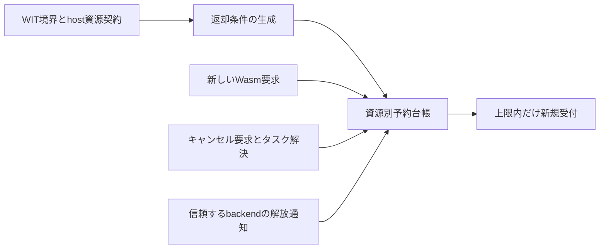

# 案C：解決と実解放を分離する非同期資源契約の生成

位置づけ: セキュリティ上の問題は明確だが、現在の3案で特許向けの優先度は最も低い。実資源の寿命に合わせる基本アルゴリズムは正しいセマフォと同じだった。残る発明仮説は、型付き非同期境界とhostの資源契約から、複数種類の返却義務を生成して漏れを防ぐ部分である。

## 問題と具体例

Wasmプラグインが重いhost処理を依頼し、すぐキャンセルを繰り返す。キャンセル通知で利用枠を戻すと、既に始まったhost処理やbufferが残ったまま次の処理が受け付けられる。タスクが結果を返しても、返したstreamやbackendの処理が資源を持ち続ける場合がある。

Component Modelのタスク解決規則はすでに存在する。ここで区別する対象は、キャンセル要求、タスクの解決、**課金・制限対象となる個々の実資源の解放**である。「task.returnならすべてのhost資源が消える」という前提を置かない。

## 構成



資源種類ごとに上限Q、予約Rを持つ。たとえばtask slot、保留buffer byte、backend worker slotは別の列である。予約レコードは`allocation ID, generation, tenant, cost vector, release obligations`を持つ。

ホスト実装者は、各操作が何を確保するか、どの通知が解放を証明するか、stream等へ所有が移るかを契約に書く。WIT単体からOS資源の費用や終了を推定することはできない。生成器は所有移動と義務の遷移を接続する。不可視な資源について「全体を制限した」と主張しない。

## 核となる規則

```text
admit(cost):
    atomically require reserved + cost <= quota
    create an allocation record and add cost to reserved

cancel_requested(task):
    mark cancellation intent; do not infer resource release

task_resolved(task, outcome):
    discharge only obligations that the resource contract binds to this event

backend_released(allocation, generation):
    authenticate reporter and match live allocation generation
    discharge the corresponding resource obligation exactly once
    refund its reservation only when its last obligation is discharged

transfer_resource(source, destination):
    atomically move the obligation; do not refund and then reacquire
```

安全不変条件は種類kごとに`actual_live[k] <= reserved[k] <= quota[k]`。資源生成が必ず受付を通り、costが上界で、実解放前に返却せず、通知が偽造できないなら帰納的に保たれる。未知の費用は保守的な予約・固定上限・拒否を選ぶ。時間経過だけで安全に返却できるとは限らない。

## 先行技術との差分

- [CROC Core v6](https://zenodo.org/records/22141849)はキャンセルと解決、所有権、borrowの整合性を扱う公開成果。Cはその区別を新しく発見したと主張しない。
- [AccTEE](https://cris.fau.de/publications/277973669/)や[USENIX Security 2025の資源分離研究](https://www.usenix.org/system/files/usenixsecurity25-yu-zhaofeng.pdf)により、Wasm資源会計とhost資源保護の問題は既知。
- [US10579422B2](https://patents.google.com/patent/US10579422B2/en)の請求項1は、group別の未処理taskとlatencyによる受付閾値を扱う。受付制限やquota自体は新規性にならない。
- [Tokio](https://docs.rs/tokio/latest/tokio/task/fn.spawn_blocking.html)の開始済みblocking処理がabortで止まらない性質も既知。実処理が終わるまでpermitを保持する対照を必ず含める。

狭い差分仮説は、**非同期の結果・stream・resource移動に応じて、タスクと異なる寿命を持つ資源別の返却義務を生成・合成し、二重返却と早期返却を境界で防ぐ方法**。単なるRAII／参照カウントの生成に留まるなら主発明にしない。

## 請求項のたたき台

**請求項C1（方法）**：WebAssemblyコンポーネントが非同期に利用するホスト資源の受付を制御する情報処理方法であって、型付きインターフェース記述と、各操作が確保する資源種類、予約量及び解放を確認する事象を関連付ける資源契約を取得し、非同期タスク、結果として移送される資源及びホスト側処理の間の所有移動に対応する返却義務の遷移処理を生成し、要求受付前に資源種類ごとの予約量が上限を超えないことを確認し、キャンセル要求又はタスク解決の通知から独立して前記返却義務を管理し、該当する実資源の解放を確認した返却義務についてのみ予約を一回返却する、情報処理方法。

**C2**：C1において、複数の型付き資源が同じ実資源を参照するとき、共有する資源識別及び世代に対応した返却義務を用い、全ての有効な義務が消滅するまで当該実資源の予約を保持する方法。

**C3**：C1又はC2において、タスクから戻り値のstream又はresourceへ義務を移転する際に、予約の返却と再取得を挟まず義務の帰属を原子的に更新する方法。

**C4**：C1～C3において、実解放を確認する事象を取得できない資源について、タスクの解決だけを根拠に予約を返却せず、保守的な予約保持又は受付拒否を行う方法。

C1の生成器・複数種類・所有移動は本試作では未実装。今回の実験だけで請求項全体の実施可能性を立証したとはいわない。

## 初期実験

Core WasmからNodeの模擬資源受付を呼ぶ。上限8単位、1処理2単位、32回の開始／キャンセルを試した。

|返却方式|キャンセル連打時の最大実資源|解決が実解放に先行する場合|
|---|---:|---:|
|キャンセルで返却|64|64|
|task解決で返却|8|64|
|実解放で返却|8|8|
|正しいセマフォ対照|8|8|

raw/O3、4方式、4イベント列、計32条件。重複解放を無視し、全解放後の予約0を確認。混合イベント列でも提案方式と、live allocation集合を使う独立なセマフォ対照は同一だった。これは問題と安全条件の再現であり、既存方式を超えた結果ではない。

## 修士研究としての検証・撤退条件

週8–10時間、8–10週間を仮定。単なるquota wrapperの研究にはせず、生成器が対象とする資源契約を2–3種類に限定する。通信や大量ファイルで実機を負荷攻撃する必要はなく、有限buffer、制御可能なworker、ローカルstreamで十分検証できる。

- モデル検査：開始前／開始後キャンセル、解決／解放順序、結果resourceの移動、重複通知、ID再利用、親終了、通知欠損。
- 対照：正しいRAII/セマフォ、task単位制限、全資源をtaskに一括帰属する方式。弱い早期返却だけに勝ったと報告しない。
- 指標：資源種類別の上限違反、保持過剰、正当な仕事の受付率、peak buffer、throughput、契約注釈量、生成される状態数、計装費用。
- 差分を支える実験：手書きで漏れやすい移転／aliasを生成器が正しくつなぎ、保守的な「全部の終了待ち」より早く不要な予約を返せるか。

**最大のReject理由**：正しく実装した参照カウント・セマフォ・RAIIと同じで、生成部分も通常のbinding generatorである。現段階ではこの懸念が強く、B/Aに先行して長期実装する理由はない。
